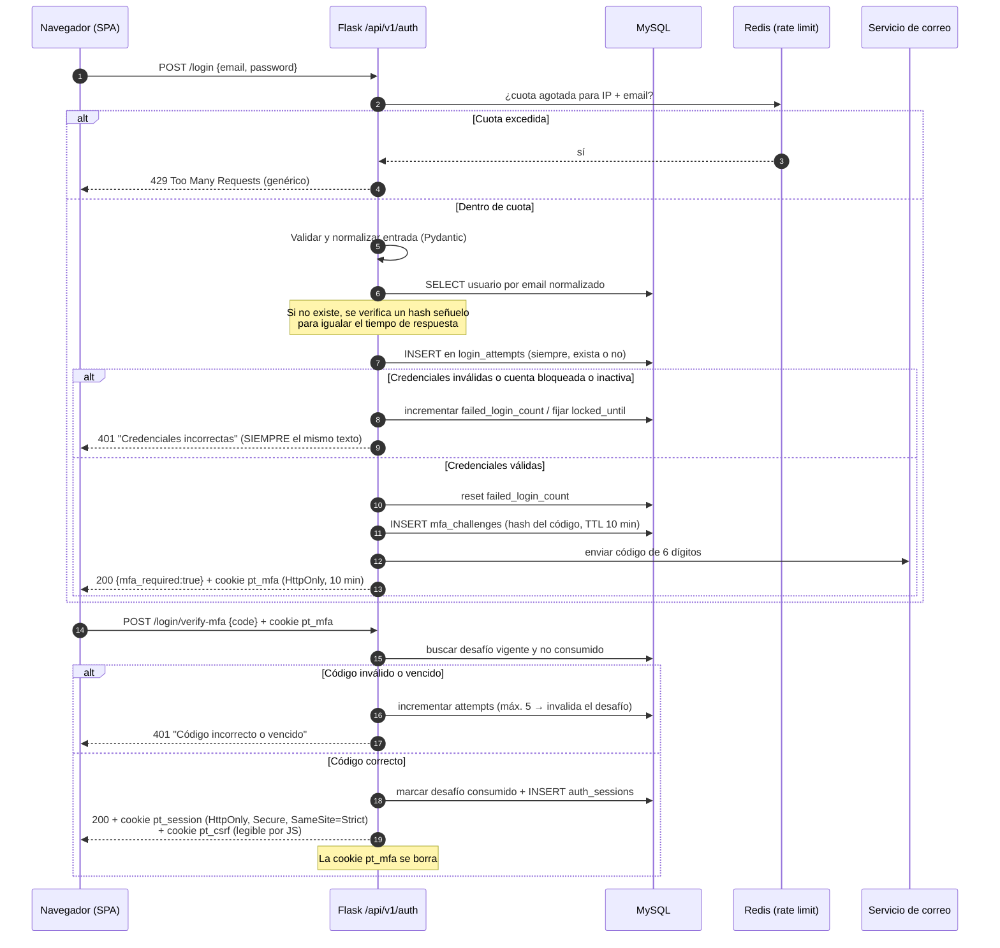
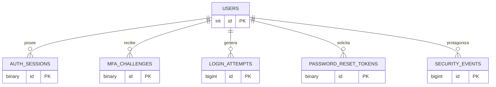
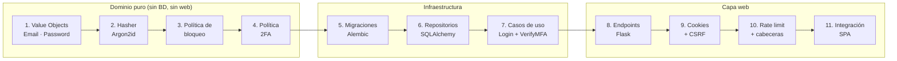

# Módulo de Autenticación — Esquema de Datos y Plan de Desarrollo
## Prime Telecom · Fase 1-A (Login Seguro) · Backend Python + Flask + MySQL

> **Alcance de este documento.** Cubre **exclusivamente el flujo de inicio de sesión**: identificación, verificación de credenciales, segundo factor por correo y establecimiento de sesión. El sistema de **Roles / RBAC queda deliberadamente fuera** y se aborda al final (§7 — Deuda planificada). Este documento extiende el *Blueprint de Arquitectura* maestro; toda decisión aquí es trazable a él o lo corrige explícitamente.

**Rol asumido:** Arquitecto de Software Senior + CISO
**Stack fijado:** Python · Flask · MySQL 8 (InnoDB) · SQLAlchemy + Alembic
**Metodología:** TDD estricto (Red → Green → Refactor)

---

## Tabla de contenido

1. [Decisión de arquitectura: módulo propio vs. Supabase/Clerk](#1-decisión-de-arquitectura-módulo-propio-vs-supabaseclerk)
2. [Modelo de sesión adoptado](#2-modelo-de-sesión-adoptado)
3. [Flujo de autenticación completo](#3-flujo-de-autenticación-completo)
4. [Esquema de Base de Datos (DDL)](#4-esquema-de-base-de-datos-ddl)
5. [Trazabilidad: directiva CISO → implementación](#5-trazabilidad-directiva-ciso--implementación)
6. [Plan de Desarrollo secuencial (TDD)](#6-plan-de-desarrollo-secuencial-tdd)
7. [Deuda planificada y fuera de alcance](#7-deuda-planificada-y-fuera-de-alcance)

---

## 1. Decisión de arquitectura: módulo propio vs. Supabase/Clerk

Se planteó usar un BaaS de autenticación (Supabase Auth, Clerk) frente a construir el módulo. **La decisión es construir el módulo propio.** El razonamiento, en términos de riesgo y no de gusto:

| Criterio | Supabase / Clerk | Módulo propio (elegido) |
|----------|------------------|-------------------------|
| **Control del dato** | Los hashes de contraseña y la identidad de los empleados viven en infraestructura de un tercero, fuera del país y fuera del alcance de la auditoría de la tesis | 100% en la MySQL de Prime Telecom. Un solo dominio de confianza |
| **Modelo de sesión** | Clerk/Supabase entregan el token al **cliente JS**; el patrón por defecto de sus SDK es `localStorage` o un store accesible desde JS. Forzar `HttpOnly` puro va a contracorriente del SDK | La cookie `HttpOnly` la emitimos nosotros. No hay SDK que pelear |
| **Superficie de ataque** | Se añade un proveedor de identidad externo: su brecha es nuestra brecha, y su caída es nuestro downtime en el login | La superficie se limita a nuestro propio endpoint |
| **Acoplamiento arquitectónico** | El dominio `Identity` del Blueprint (§1.5) dejaría de ser la fuente de verdad; `users.id` pasaría a ser un espejo de un ID externo, y el RBAC quedaría partido entre dos sistemas | `Identity` sigue siendo dueño único de *quién es quién* |
| **Defendibilidad académica** | "Delegamos la autenticación" es un capítulo corto y poco demostrable | El algoritmo de bloqueo, el anti-enumeración y el 2FA son contribución propia, medible y testeable |
| **Costo real** | Gratis hasta N usuarios, luego por MAU; además vendor lock-in de la tabla de usuarios | Cero costo recurrente |
| **Costo de construir** | — | ~3-4 días de trabajo con TDD. Es un flujo acotado y bien conocido; **no** estamos inventando criptografía, solo componiendo primitivas probadas (`argon2-cffi`, `secrets`, `hmac`) |

> **Regla que sostiene esta decisión:** no escribimos criptografía, escribimos *orquestación*. El hash lo hace Argon2id de `argon2-cffi`; la aleatoriedad la da `secrets` (CSPRNG del SO); la comparación la hace `hmac.compare_digest`. Construir el módulo propio es seguro precisamente porque cada primitiva delicada está delegada a una biblioteca auditada.

### 1.1 Stack de dependencias del módulo

```
Flask                    # framework web
SQLAlchemy + Alembic     # ORM y migraciones (nunca SQL por concatenación)
argon2-cffi              # hashing de contraseñas (Argon2id)
Flask-Limiter + redis    # rate limiting distribuido
pydantic                 # validación estricta de entrada
python-dotenv            # secretos fuera del código
pytest + pytest-cov      # TDD
```

---

## 2. Modelo de sesión adoptado

> ⚠️ **Supuesto asumido** (esta pregunta quedó sin responder): se adopta la **opción recomendada — sesión opaca persistida en base de datos**. Si prefieres JWT stateless, dímelo antes de la Fase 6.3 y ajusto `auth_sessions`; el resto del esquema no cambia.

Esto **corrige conscientemente** el §1.3 del Blueprint maestro, que proponía JWT stateless en cabecera `Authorization`. La directiva CISO nº 5 (prohibido `localStorage`, verificación siempre en servidor) hace que el JWT pierda su única ventaja real —no consultar la base de datos— sin ganar nada:

- **JWT no se puede revocar.** Un despido, un robo de sesión o un cambio de contraseña no invalidan un JWT ya emitido hasta que expire. La solución habitual (una *blocklist* en BD) reintroduce exactamente la consulta que el JWT pretendía evitar, pero con peor semántica.
- **El token opaco no contiene nada.** Es 32 bytes de entropía del CSPRNG. Aunque un atacante lo lea, no hay claims que manipular ni firma que atacar (`alg:none`, confusión HS256/RS256, etc. dejan de existir como clase de vulnerabilidad).
- **El costo es un `SELECT` por request** sobre una clave primaria indexada — microsegundos, despreciable frente al viaje de red.

### 2.1 Anatomía de la cookie de sesión

```
Set-Cookie: pt_session=<48 caracteres base64url>;
            HttpOnly;          # JS no puede leerla → mitiga XSS (directiva 5)
            Secure;            # solo por HTTPS → mitiga sniffing
            SameSite=Strict;   # el navegador no la envía en peticiones cross-site → mitiga CSRF
            Path=/;
            Max-Age=28800      # 8 h; sin Max-Age en modo "sesión de navegador"
```

**En la base de datos nunca se guarda el token, sino su `SHA-256`.** Si alguien lee la tabla `auth_sessions` (backup filtrado, SQLi de solo lectura, DBA curioso) no puede suplantar a nadie: el hash no es reversible y no sirve como cookie.

---

## 3. Flujo de autenticación completo

El login es un flujo de **dos pasos con estados intermedios explícitos**. Nunca se emite la cookie de sesión antes de superar el segundo factor.



### 3.1 Endpoints del módulo

| Método | Ruta | Propósito | Rate limit |
|--------|------|-----------|------------|
| `POST` | `/api/v1/auth/login` | Paso 1: email + contraseña | 5/min por IP · 5/15 min por cuenta |
| `POST` | `/api/v1/auth/login/verify-mfa` | Paso 2: código de 6 dígitos | 5 intentos por desafío · 10/min por IP |
| `POST` | `/api/v1/auth/login/resend-mfa` | Reenvío del código | 1/min · máx. 3 por desafío |
| `POST` | `/api/v1/auth/logout` | Revoca la sesión actual | 20/min |
| `GET`  | `/api/v1/auth/me` | Devuelve el usuario de la cookie (la SPA lo llama al arrancar) | 60/min |
| `POST` | `/api/v1/auth/password/change` | Cambio voluntario: exige sesión válida **y** la contraseña actual. Revoca todas las demás sesiones | 5/hora |
| `POST` | `/api/v1/auth/password/forgot` | Solicita el enlace de restablecimiento. Responde `202` idéntico exista o no la cuenta | 3/hora por IP |
| `POST` | `/api/v1/auth/password/reset` | Consume el token del correo. Revoca todas las sesiones | 5/hora por IP |

> **Nota deliberada:** no existe endpoint de registro público. Los usuarios internos los crea un `ADMIN` (fuera del alcance de este documento). No hay auto-servicio de alta = una superficie de ataque menos.
>
> **Desbloqueo administrativo:** no es un endpoint HTTP en esta fase, sino un comando de consola (`flask auth unlock <email>`) que pone `locked_until=NULL`, `lockout_level=0` y emite `ACCOUNT_UNLOCKED` en `security_events`. Sin esta salida, un bloqueo prolongado solo se resuelve con un `UPDATE` manual del DBA — inaceptable.
>
> **Verificación de correo:** en esta fase **no** hay flujo de auto-verificación. El script de siembra y el alta por `ADMIN` escriben `email_verified_at = NOW()` porque el correo corporativo ya está validado fuera de banda (lo crea el propio departamento de sistemas). El valor `EMAIL_VERIFY` del ENUM queda reservado para cuando exista alta con correo externo.

### 3.2 Obtención de la IP del cliente (precondición de todo el rate limiting)

La aplicación corre detrás de un proxy inverso (Nginx / balanceador). `request.remote_addr` devuelve entonces la IP **del proxy**, no la del cliente, y `Flask-Limiter` la usa por defecto. Las dos salidas ingenuas están rotas:

- **No tocar nada:** todos los empleados comparten la misma clave de cuota. Seis logins en un minuto y el sexto recibe `429`; un solo atacante deja el login caído para toda la plantilla con 6 peticiones. Además, `login_attempts.ip_address` guarda la IP del proxy en cada fila y el índice `idx_att_ip_time` deja de servir para nada.
- **Leer `X-Forwarded-For` a pelo:** el cliente controla esa cabecera. El atacante la rota en cada petición (`1.2.3.4`, `1.2.3.5`, …), cada valor abre un cubo de Redis nuevo y **el límite por IP deja de existir**. De paso puede fabricar evidencia falsa en la bitácora apuntando a la IP de un tercero.

**Regla obligatoria:** `app.wsgi_app = ProxyFix(app.wsgi_app, x_for=N, x_proto=1, x_host=1)` con **N = número exacto de proxies de confianza** en la cadena de despliegue (no `1` por inercia). `ProxyFix` toma el N-ésimo valor **desde la derecha** de `X-Forwarded-For`, que es el único que un cliente no puede falsificar. Si llega `X-Forwarded-For` y no hay proxy de confianza configurado, la petición se rechaza. Este ajuste es precondición de las cuotas de §3.1: sin él, la directiva 3 no se cumple aunque el código de rate limiting sea perfecto.

---

## 4. Esquema de Base de Datos (DDL)

Seis tablas. Cinco son nuevas; `users` extiende la definición del Blueprint maestro (§2.3) con las columnas de seguridad.

> **Orden de migración.** `users.role_id` referencia `roles`, tabla que pertenece al RBAC — fuera de alcance. Si la migración inicial declara esa FK contra una tabla inexistente, `alembic upgrade head` falla en la primera sentencia con `errno 150`. La migración inicial de esta fase crea, por tanto, un `roles` mínimo (`id`, `code`, `name`) y siembra una fila `code='ADMIN'`, para que exista un `role_id` válido antes del primer usuario. La fase RBAC ampliará esa tabla, no la creará.



### 4.1 `users` — identidad y estado de seguridad de la cuenta

```sql
CREATE TABLE users (
    id                    INT UNSIGNED AUTO_INCREMENT PRIMARY KEY,
    role_id               INT UNSIGNED NOT NULL,          -- RBAC: fase posterior
    full_name             VARCHAR(120) NOT NULL,

    -- ===== Identificación =====
    -- El email se guarda SIEMPRE normalizado (trim + lower). La unicidad se aplica
    -- sobre esa forma normalizada, para que Admin@X.com y admin@x.com no coexistan.
    -- COLACIÓN EXPLÍCITA as_cs (accent- y case-SENSITIVE): la colación por defecto
    -- de MySQL 8, utf8mb4_0900_ai_ci, es accent-insensitive, así que jose@x.com y
    -- josé@x.com serían la MISMA fila para la BD pero cadenas distintas para la
    -- aplicación (y por tanto HMAC distintos). Esa discrepancia permite multiplicar
    -- la cuota "por cuenta" generando variantes acentuadas. La app normaliza; la BD
    -- compara byte a byte. Una sola regla, en un solo sitio.
    email                 VARCHAR(160) NOT NULL COLLATE utf8mb4_0900_as_cs,
    email_verified_at     DATETIME NULL,                  -- una cuenta sin verificar no puede iniciar sesión

    -- ===== Credencial =====
    -- Argon2id produce un hash con formato PHC:
    -- $argon2id$v=19$m=65536,t=3,p=4$<salt b64>$<hash b64>  (~100 chars; 255 da margen a rehash)
    password_hash         VARCHAR(255) NOT NULL,
    password_algo         VARCHAR(30)  NOT NULL DEFAULT 'argon2id',  -- permite migrar de algoritmo sin downtime
    password_updated_at   DATETIME     NOT NULL DEFAULT CURRENT_TIMESTAMP,
    must_change_password  BOOLEAN      NOT NULL DEFAULT FALSE,       -- TRUE en el alta por ADMIN

    -- ===== Anti fuerza bruta (directiva 3) =====
    failed_login_count    SMALLINT UNSIGNED NOT NULL DEFAULT 0,
    last_failed_login_at  DATETIME NULL,
    locked_until          DATETIME NULL,                  -- NULL = sin bloqueo. Bloqueo temporal, nunca permanente
    lockout_level         TINYINT UNSIGNED NOT NULL DEFAULT 0,  -- nº de bloqueos seguidos → backoff acotado
    lockout_level_decays_at DATETIME NULL,                -- el nivel baja solo con el tiempo, no solo tras un éxito

    -- ===== Segundo factor (directiva 6) =====
    mfa_enabled           BOOLEAN NOT NULL DEFAULT TRUE,  -- política: 2FA por correo en CADA login
    mfa_method            ENUM('EMAIL_OTP') NOT NULL DEFAULT 'EMAIL_OTP',  -- ENUM = espacio para TOTP futuro

    -- ===== Ciclo de vida =====
    is_active             BOOLEAN  NOT NULL DEFAULT TRUE, -- baja lógica; jamás DELETE (rompe la auditoría)
    last_login_at         DATETIME NULL,
    created_at            DATETIME NOT NULL DEFAULT CURRENT_TIMESTAMP,
    updated_at            DATETIME NOT NULL DEFAULT CURRENT_TIMESTAMP ON UPDATE CURRENT_TIMESTAMP,

    CONSTRAINT fk_users_role FOREIGN KEY (role_id) REFERENCES roles(id),
    UNIQUE KEY uq_users_email (email),
    INDEX idx_users_locked (locked_until)
) ENGINE=InnoDB DEFAULT CHARSET=utf8mb4 COLLATE=utf8mb4_0900_ai_ci;
```

**Por qué cada columna sensible existe:**

- **`locked_until` en vez de un booleano `is_locked`:** el bloqueo es *temporal y auto-expirante*. Un booleano exigiría un proceso que lo limpie (y si falla, deja usuarios encerrados). Una fecha se evalúa sola: `locked_until IS NULL OR locked_until < NOW()`.
- **`lockout_level` con backoff ACOTADO:** 1er bloqueo → 5 min; 2º → 15 min; 3º en adelante → **60 min, y ahí se queda**. El escalón de 24 h que contemplaba el borrador era un arma de denegación regalada al atacante: con la convención de correo corporativo sacada de LinkedIn y 20 peticiones por víctima, cualquiera dejaba a la plantilla entera fuera del sistema un día completo, renovable. 60 minutos siguen siendo un freno real a la fuerza bruta (5 intentos/hora) y un daño soportable si se usa como ataque.
- **`lockout_level_decays_at`:** el nivel **baja solo**, restando 1 por cada 24 h sin fallos. Sin esto, el único modo de bajarlo era un login exitoso — que exige no estar bloqueado, lo que cierra la trampa sobre la víctima.
- **Salida administrativa obligatoria:** `flask auth unlock <email>` (§3.1). Un mecanismo de bloqueo sin mecanismo de desbloqueo no es una defensa, es una avería con retardo.
- **El contador se resetea al superar el SEGUNDO factor, no el primero.** Si se reseteara al validar la contraseña, quien la tuviera podría mantener la cuenta permanentemente desbloqueada y fallar el OTP indefinidamente.
- **`password_algo`:** cuando en dos años haya que subir los parámetros de Argon2, esta columna permite **rehash perezoso** (al siguiente login exitoso, con la contraseña en claro momentáneamente disponible, se recalcula el hash) sin forzar un reseteo masivo.
- **`email_verified_at`:** un correo no verificado no puede recibir el código 2FA de forma confiable. Sin este campo, el segundo factor es una ilusión.

### 4.2 `auth_sessions` — sesiones vivas (la cookie `HttpOnly`)

```sql
CREATE TABLE auth_sessions (
    id                  BINARY(16) PRIMARY KEY,           -- UUIDv4 empaquetado; identificador interno
    user_id             INT UNSIGNED NOT NULL,

    -- NUNCA se almacena el token en claro. Se guarda SHA-256 del token de 32 bytes.
    -- El token vive solo en la cookie del navegador; la BD guarda una huella irreversible.
    token_hash          BINARY(32) NOT NULL,

    -- Secreto CSRF ATADO A LA SESIÓN (ver §5.1). Es lo que convierte el double-submit
    -- en una defensa real: el servidor compara la cabecera contra ESTE valor, no
    -- contra la cookie consigo misma.
    csrf_hash           BINARY(32) NOT NULL,

    -- ===== Vigencia doble =====
    issued_at           DATETIME NOT NULL DEFAULT CURRENT_TIMESTAMP,
    idle_expires_at     DATETIME NOT NULL,   -- se renueva con la actividad (deslizante, 30 min)
    absolute_expires_at DATETIME NOT NULL,   -- techo duro; NO se renueva jamás (8 h)

    -- ===== Contexto para detección de anomalías =====
    ip_address          VARBINARY(16) NULL,  -- INET6_ATON: 4 bytes IPv4, 16 IPv6. Dato personal → ver §7
    user_agent_hash     BINARY(32) NULL,     -- hash del UA: detecta robo de cookie sin almacenar el string
    last_seen_at        DATETIME NOT NULL DEFAULT CURRENT_TIMESTAMP,

    -- ===== Revocación =====
    revoked_at          DATETIME NULL,
    revoke_reason       ENUM('LOGOUT','PASSWORD_CHANGED','ADMIN_REVOKED',
                             'IDLE_TIMEOUT','ABSOLUTE_TIMEOUT','SUSPICIOUS')
                        NULL,

    CONSTRAINT fk_sess_user FOREIGN KEY (user_id) REFERENCES users(id),
    UNIQUE KEY uq_sess_token (token_hash),      -- búsqueda O(1) por cookie + imposibilita colisión
    INDEX idx_sess_user_live (user_id, revoked_at),
    INDEX idx_sess_cleanup (absolute_expires_at)
) ENGINE=InnoDB DEFAULT CHARSET=utf8mb4;
```

**Decisiones destacadas:**

- **Dos vencimientos, no uno.** `idle_expires_at` expulsa al usuario que dejó el navegador abierto y se fue a almorzar; `absolute_expires_at` garantiza que **ninguna** sesión viva más de 8 h aunque se refresque sin parar. Con un solo timeout deslizante, una sesión robada se puede mantener viva indefinidamente.
- **`user_agent_hash` en vez del User-Agent completo:** sirve para detectar que la misma cookie apareció de golpe en otro navegador (señal de robo), sin acumular strings de *fingerprinting* que son dato personal.
- **`revoke_reason` como ENUM:** convierte el logout en un evento de auditoría legible. "¿Por qué se cerró esta sesión?" tiene respuesta.
- **Revocación en cascada:** al cambiar la contraseña se ejecuta `UPDATE auth_sessions SET revoked_at=NOW(), revoke_reason='PASSWORD_CHANGED' WHERE user_id=? AND revoked_at IS NULL`. Esto es exactamente lo que un JWT **no** puede hacer.

### 4.3 `login_attempts` — bitácora de cada intento (directiva 3)

```sql
CREATE TABLE login_attempts (
    id             BIGINT UNSIGNED AUTO_INCREMENT PRIMARY KEY,

    -- user_id es NULLABLE a propósito: se registra el intento AUNQUE el correo no exista.
    -- Sin esto, un atacante que sondea correos inexistentes no dejaría rastro alguno.
    user_id        INT UNSIGNED NULL,

    -- El correo tecleado se guarda HASHEADO (HMAC-SHA256 con pepper de aplicación).
    -- Permite agrupar y contar intentos por identidad SIN convertir esta tabla en una
    -- lista de correos válidos e inválidos legible por cualquiera que la consulte.
    email_hmac     BINARY(32) NOT NULL,

    ip_address     VARBINARY(16) NULL,
    user_agent_hash BINARY(32) NULL,

    outcome        ENUM('SUCCESS','BAD_PASSWORD','UNKNOWN_EMAIL','ACCOUNT_LOCKED',
                        'ACCOUNT_INACTIVE','EMAIL_UNVERIFIED','MFA_FAILED','MFA_SUCCESS',
                        'RATE_LIMITED')
                   NOT NULL,
    attempted_at   DATETIME NOT NULL DEFAULT CURRENT_TIMESTAMP,

    CONSTRAINT fk_att_user FOREIGN KEY (user_id) REFERENCES users(id) ON DELETE SET NULL,
    INDEX idx_att_email_time (email_hmac, attempted_at),   -- conteo de fallos por cuenta
    INDEX idx_att_ip_time (ip_address, attempted_at),      -- detección de ataque distribuido por IP
    INDEX idx_att_cleanup (attempted_at)                   -- purga por retención
) ENGINE=InnoDB DEFAULT CHARSET=utf8mb4;
```

> **La distinción granular de `outcome` es solo interna.** La API responde **siempre** el mismo `401 {"error":"Credenciales incorrectas"}` en `BAD_PASSWORD`, `UNKNOWN_EMAIL`, `ACCOUNT_LOCKED`, `ACCOUNT_INACTIVE` y `EMAIL_UNVERIFIED`. El detalle vive en la bitácora para el analista de seguridad; **jamás viaja al cliente** (directiva 4). Registrar `ACCOUNT_LOCKED` por separado es lo que permite, más adelante, alertar de un ataque en curso.

### 4.4 `mfa_challenges` — el segundo factor por correo (directiva 6)

```sql
CREATE TABLE mfa_challenges (
    id            BINARY(16) PRIMARY KEY,               -- UUIDv4
    user_id       INT UNSIGNED NOT NULL,

    -- El código de 6 dígitos NUNCA se guarda en claro: el espacio es de solo 10^6,
    -- así que un volcado de esta tabla permitiría completar el 2FA de todos.
    -- Se guarda HMAC-SHA256(código, pepper) y se compara con hmac.compare_digest.
    code_hmac     BINARY(32) NOT NULL,

    purpose       ENUM('LOGIN','PASSWORD_RESET','EMAIL_VERIFY') NOT NULL DEFAULT 'LOGIN',

    -- Vínculo con el paso 1: hash del token de la cookie pt_mfa emitida tras validar
    -- la contraseña. Impide que alguien salte directo a /verify-mfa con un código
    -- adivinado o interceptado, sin haber superado el primer factor.
    preauth_hash  BINARY(32) NOT NULL,

    attempts      TINYINT UNSIGNED NOT NULL DEFAULT 0,  -- máx. 5; al llegar, el desafío muere
    max_attempts  TINYINT UNSIGNED NOT NULL DEFAULT 5,
    resend_count  TINYINT UNSIGNED NOT NULL DEFAULT 0,  -- máx. 3; evita usar el login como spam-cannon

    ip_address    VARBINARY(16) NULL,
    created_at    DATETIME NOT NULL DEFAULT CURRENT_TIMESTAMP,
    expires_at    DATETIME NOT NULL,                    -- created_at + 10 min
    consumed_at   DATETIME NULL,                        -- un código se usa UNA vez (anti-replay)

    CONSTRAINT fk_mfa_user FOREIGN KEY (user_id) REFERENCES users(id) ON DELETE CASCADE,
    UNIQUE KEY uq_mfa_preauth (preauth_hash),
    INDEX idx_mfa_user_live (user_id, consumed_at, expires_at),
    INDEX idx_mfa_cleanup (expires_at)
) ENGINE=InnoDB DEFAULT CHARSET=utf8mb4;
```

**Reglas de negocio que esta tabla hace cumplir:**

1. **Un solo desafío vivo por usuario.** Al crear uno nuevo se invalidan los anteriores no consumidos (`UPDATE ... SET consumed_at=NOW()`). Sin esto, un atacante podría pedir 500 códigos y tener 500 oportunidades simultáneas de acierto.
2. **`consumed_at` bloquea el replay.** Un código usado no se vuelve a aceptar aunque no haya expirado.
3. **`preauth_hash` ata los dos pasos.** Sin él, `/verify-mfa` sería un endpoint independiente atacable por fuerza bruta sobre 10⁶ combinaciones sin conocer la contraseña.
4. **`attempts` + `expires_at` reducen la probabilidad de acierto** a 5 intentos en 600 segundos ≈ **1 en 200.000** por desafío.
5. **Semántica exacta del reenvío** (`/login/resend-mfa`): **actualiza la fila existente**, no crea una nueva. Mismo `preauth_hash` (la cookie `pt_mfa` del navegador sigue siendo válida), nuevo `code_hmac`, `resend_count += 1`, y —esto es lo importante— **`expires_at` NO se extiende y `attempts` NO se resetea**. Si el reenvío creara una fila nueva chocaría con `uq_mfa_preauth`, o bien invalidaría la cookie que el usuario tiene en la mano; y si reseteara `attempts`, 3 reenvíos × 5 intentos darían **20** adivinanzas por contraseña validada, no 5, tirando por tierra el cálculo de arriba.
6. **Tope de desafíos por cuenta:** máximo 5 desafíos por usuario cada 15 minutos, contados con `SELECT COUNT(*) ... WHERE user_id=? AND created_at > NOW()-INTERVAL 15 MINUTE`. En MySQL, no en Redis: debe sobrevivir a un reinicio. Sin este tope, quien tenga la contraseña vuelve al paso 1 tantas veces como quiera y consigue tiradas infinitas de 5 códigos — y, de paso, convierte el login en un cañón de correo contra la víctima.
7. **Un fallo de MFA cuenta como fallo de login.** `MFA_FAILED` y `MFA_EXHAUSTED` incrementan `users.failed_login_count` y alimentan la misma `LockoutPolicy` que los fallos de contraseña. Si el segundo factor no bloqueara nada, sería un muro con una puerta al lado.
8. **El estado de la cuenta se re-valida en el paso 2.** Entre el paso 1 y el 2 pueden pasar 10 minutos; en ese rato un `ADMIN` puede haber desactivado al usuario. `VerifyMfaUseCase` vuelve a cargar la fila y comprueba `is_active` y `locked_until` antes de crear la sesión.

### 4.5 `password_reset_tokens` — restablecimiento (superficie adyacente al login)

```sql
-- Se incluye aquí porque el "olvidé mi contraseña" es una VÍA DE ENTRADA al login:
-- un reseteo débil hace irrelevante lo robusto que sea el login.
CREATE TABLE password_reset_tokens (
    id           BINARY(16) PRIMARY KEY,
    user_id      INT UNSIGNED NOT NULL,
    token_hash   BINARY(32) NOT NULL,       -- SHA-256 del token de 32 bytes enviado por correo
    requested_ip VARBINARY(16) NULL,
    created_at   DATETIME NOT NULL DEFAULT CURRENT_TIMESTAMP,
    expires_at   DATETIME NOT NULL,         -- 30 min, corto a propósito
    consumed_at  DATETIME NULL,             -- un solo uso
    CONSTRAINT fk_prt_user FOREIGN KEY (user_id) REFERENCES users(id) ON DELETE CASCADE,
    UNIQUE KEY uq_prt_token (token_hash),
    INDEX idx_prt_user_live (user_id, consumed_at),
    INDEX idx_prt_cleanup (expires_at)
) ENGINE=InnoDB DEFAULT CHARSET=utf8mb4;
```

> El endpoint de solicitud responde **`202 Accepted` con el mismo mensaje siempre**, exista o no el correo (directiva 4). Al consumir el token se revocan todas las `auth_sessions` del usuario.

### 4.6 `security_events` — auditoría de alto nivel

```sql
-- login_attempts es de grano fino y alto volumen (se purga a 90 días).
-- security_events es de grano grueso y baja frecuencia: la línea de tiempo que se
-- consulta durante una investigación. Retención larga.
CREATE TABLE security_events (
    id          BIGINT UNSIGNED AUTO_INCREMENT PRIMARY KEY,
    user_id     INT UNSIGNED NULL,
    event_type  ENUM('ACCOUNT_LOCKED','ACCOUNT_UNLOCKED','PASSWORD_CHANGED',
                     'PASSWORD_RESET_REQUESTED','PASSWORD_RESET_COMPLETED',
                     'SESSION_REVOKED','MFA_EXHAUSTED','SUSPICIOUS_SESSION_REUSE',
                     'USER_DEACTIVATED','USER_ACTIVATED')
                NOT NULL,
    detail      JSON NULL,                  -- contexto estructurado; NUNCA credenciales ni tokens
    ip_address  VARBINARY(16) NULL,
    created_at  DATETIME NOT NULL DEFAULT CURRENT_TIMESTAMP,
    CONSTRAINT fk_sev_user FOREIGN KEY (user_id) REFERENCES users(id) ON DELETE SET NULL,
    INDEX idx_sev_user_time (user_id, created_at),
    INDEX idx_sev_type_time (event_type, created_at)
) ENGINE=InnoDB DEFAULT CHARSET=utf8mb4;
```

### 4.7 Sobre el rate limiting: por qué **no** hay tabla

El *rate limiting* (directiva 3) se implementa en **Redis**, no en MySQL. Un contador por IP se escribe en cada petición, incluidas las de un ataque: llevarlo a MySQL significa convertir una inundación de peticiones en una inundación de escrituras a disco — el limitador se vuelve el amplificador del DoS que debía frenar. Redis mantiene los contadores en memoria con expiración nativa (`INCR` + `EXPIRE`).

`login_attempts` **no es** el limitador: es la bitácora forense y la fuente del bloqueo *por cuenta* (que sí es persistente, porque debe sobrevivir a un reinicio de Redis). Son dos mecanismos con dos propósitos:

| Mecanismo | Dónde | Protege contra | Se pierde al reiniciar |
|-----------|-------|----------------|------------------------|
| Rate limit por IP/ruta | Redis | Inundación, bots, credential stuffing distribuido | Sí (aceptable) |
| Bloqueo por cuenta (`locked_until`) | MySQL | Fuerza bruta dirigida a un usuario concreto | No (crítico) |
| Bitácora (`login_attempts`) | MySQL | Nada por sí sola; alimenta detección y auditoría | No |

**Degradación segura:** si Redis cae, el limitador **no** debe abrirse. `Flask-Limiter` se configura con `in_memory_fallback` para no dejar el endpoint desnudo.

---

## 5. Trazabilidad: directiva CISO → implementación

| # | Directiva | Cómo se cumple | Dónde se prueba |
|---|-----------|----------------|-----------------|
| 1 | **Anti-SQLi y sanitización** | 100% SQLAlchemy con parámetros vinculados; **cero** f-strings o concatenación en SQL. Validación de entrada con Pydantic: `EmailStr` (RFC 5322), longitud máxima de email 160 y de contraseña 128 (corta el DoS por Argon2 con entrada gigante), normalización `strip().lower()`. **No** se "limpia" la contraseña quitando caracteres: se acepta cualquier byte y se hashea; filtrar comillas es un antipatrón que debilita las claves | `test_sqli_payloads_no_alteran_la_consulta`, `test_email_invalido_rechazado_con_422` |
| 2 | **Criptografía** | **Argon2id** (`argon2-cffi`), parámetros `m=64 MiB, t=3, p=4` — ganador del Password Hashing Competition y resistente a GPU/ASIC, superior a bcrypt. Salt aleatorio por usuario generado por la propia biblioteca. Tokens con `secrets.token_bytes(32)`. Comparaciones con `hmac.compare_digest` (tiempo constante). Cero texto plano en BD, en logs y en respuestas | `test_hash_nunca_igual_al_plano`, `test_dos_usuarios_misma_clave_hashes_distintos` |
| 3 | **Anti-bots y fuerza bruta** | Tres capas: rate limit Redis por IP y por cuenta · `failed_login_count` + `locked_until` con **backoff exponencial** vía `lockout_level` · bitácora completa en `login_attempts`. El costo de Argon2 (~100 ms) es en sí mismo un freno | `test_5_fallos_bloquean_la_cuenta`, `test_bloqueo_expira_solo`, `test_backoff_crece` |
| 4 | **Anti-enumeración** | Un único mensaje `"Credenciales incorrectas"` y un único código `401` para las 5 causas de fallo. **Presupuesto de tiempo fijo:** ver §5.3. El envío del correo de reseteo se **encola siempre**, exista o no la cuenta, para que la latencia del SMTP no delate nada; la respuesta es `202` idéntica. El bloqueo **no** se anuncia | `test_mensaje_identico_para_las_5_causas`, `test_tiempo_igual_en_las_5_causas`, `test_forgot_encola_siempre` |
| 5 | **Mitigación XSS** | Token de sesión **solo** en cookie `HttpOnly; Secure; SameSite=Strict`. Cero `localStorage`/`sessionStorage`. La SPA nunca ve ni maneja el token. Toda autorización se resuelve en servidor leyendo la cookie; lo que el frontend oculte o muestre es cosmético y no confiable. Cabeceras `Content-Security-Policy`, `X-Content-Type-Options: nosniff`, `Referrer-Policy` y `HSTS` en cada respuesta | `test_cookie_tiene_httponly_secure_samesite`, `test_respuesta_de_login_no_contiene_el_token_en_el_body` |
| 6 | **2FA por correo** | Tabla `mfa_challenges` completa: código de 6 dígitos generado con `secrets.randbelow`, guardado como HMAC, TTL de 10 min, un solo uso, máx. 5 intentos, máx. 3 reenvíos, atado al paso 1 por `preauth_hash`. **La cookie de sesión se emite únicamente después del segundo factor** | `test_sin_mfa_no_hay_cookie_de_sesion`, `test_codigo_expirado_rechazado`, `test_codigo_no_se_reusa` |

### 5.0 El señuelo no basta: presupuesto de tiempo fijo

El borrador de este documento proponía verificar un hash señuelo cuando el correo no existe, para que ese caso tardara lo mismo que una contraseña incorrecta. **Iguala dos de los cinco caminos.** Los otros tres —cuenta bloqueada, inactiva, correo no verificado— cortan *antes* de llegar a Argon2 en cualquier implementación natural, y ahí es donde se abre el oráculo:

1. El atacante mide la línea base con un correo basura: ~100 ms (el costo de Argon2).
2. Prueba `nombre.apellido@primetelecom.com`: también ~100 ms. Todavía no sabe nada.
3. **Usa el bloqueo como amplificador:** envía 5 intentos fallidos contra ese correo. Si la cuenta existe, queda bloqueada.
4. Sexto intento, cronómetro en mano. Correo inexistente → ~100 ms (paga el señuelo). Correo existente y ahora bloqueado → **~5 ms**, porque el código corta en `locked_until` antes de hashear.
5. Veinte veces de diferencia, muy por encima del ruido de red. Enumera el directorio completo de empleados a 6 peticiones por correo, con un `401` idéntico en todos los casos.

**Corrección, dos capas:**

- **Orden fijo:** se ejecuta **siempre** la verificación Argon2 (contra el hash real o contra el señuelo) **antes** de evaluar `locked_until`, `is_active` y `email_verified_at`. El `outcome` se decide al final, cuando todos los caminos ya han pagado el mismo costo.
- **Deadline en el handler:** `t0 = monotonic()` al entrar; antes de responder, `sleep` hasta `t0 + 250 ms`. Convierte el tiempo de respuesta en una constante, no en una función de la rama tomada.

El test `test_tiempo_igual_en_las_5_causas` mide las cinco causas de fallo, no dos, y exige que la desviación quede por debajo del umbral.

### 5.1 Riesgo añadido por el propio diseño: CSRF

Pasar de `Authorization: Bearer` (inmune a CSRF por construcción) a **cookies** reintroduce el **Cross-Site Request Forgery**, riesgo que la lista original de directivas no contemplaba. Se mitiga en dos capas:

1. **`SameSite=Strict`** en la cookie de sesión: el navegador no la adjunta en peticiones originadas en otro sitio. Cubre el caso general.
2. **Token CSRF atado a la sesión** (no double-submit puro). El double-submit clásico —comparar la cookie `pt_csrf` contra la cabecera `X-CSRF-Token`— **se derrota desde cualquier subdominio**, y conviene entender por qué antes de descartarlo: las cookies no están aisladas por origen. Un subdominio abandonado o comprometido (`algo.primetelecom.com`: un bucket, un entorno de pruebas viejo, un panel de un proveedor) puede escribir `document.cookie = "pt_csrf=AAAA; Domain=.primetelecom.com"` y sobrescribir la de la aplicación. `SameSite=Strict` **no lo impide**, porque "same-site" se evalúa a nivel de dominio registrable y ese subdominio es same-site. El atacante emite entonces la petición con `X-CSRF-Token: AAAA`, cookie y cabecera coinciden, y el servidor la da por buena.

   La corrección es guardar el secreto en el servidor: `auth_sessions.csrf_hash` (§4.2). Al crear la sesión se genera un token CSRF de 32 bytes, se envía en la cookie `pt_csrf` (legible por JS, transporte hacia la SPA) y se guarda su `SHA-256` en la fila. En cada método mutante el servidor valida `hmac.compare_digest(sha256(cabecera), fila.csrf_hash)` — **la cookie nunca se compara consigo misma**. Un valor inyectado desde un subdominio no coincide con nada.

3. **Prefijo `__Host-` en la cookie de sesión:** `__Host-pt_session`. El navegador solo acepta una cookie con ese prefijo si va marcada `Secure`, con `Path=/` y **sin atributo `Domain`** — lo que la ata al host exacto e impide que un subdominio la sobrescriba. Es una línea de configuración y elimina toda una clase de ataque.

4. **Validación de `Origin`:** en todo `POST`/`PUT`/`PATCH`/`DELETE` se comprueba que la cabecera `Origin` esté en la lista blanca. Es una tercera red, independiente de las cookies.

Se añade además validación estricta de **CORS** (lista blanca del origen de la SPA, `Access-Control-Allow-Credentials: true`, **nunca** `Origin: *` con credenciales).

### 5.2 Riesgo residual aceptado: el 2FA por correo es de un solo canal

Los dos factores del login son "algo que sabes" (contraseña) y "algo que recibes en el correo". El restablecimiento de contraseña se apoya **solo en el segundo**: quien controla el buzón pide el enlace, fija una contraseña nueva y a partir de ahí tiene ambos factores. El correo es, por tanto, el punto único de fallo de todo el sistema de identidad.

No se elimina el riesgo —no hay un segundo canal disponible en el alcance de esta fase— pero se acota:

- El **cambio voluntario** de contraseña (`/password/change`) exige sesión válida **y** la contraseña actual. El reseteo por correo queda reservado al caso de olvido real.
- Consumir un token de reseteo **invalida todos** los `mfa_challenges` y `password_reset_tokens` vivos del usuario, y revoca todas sus sesiones.
- Todo reseteo completado emite `PASSWORD_RESET_COMPLETED` en `security_events` y **notifica al usuario**, para que un reseteo que él no pidió sea visible.
- Se documenta como riesgo aceptado: **la seguridad del buzón corporativo es una precondición del sistema.** Cuando el proyecto pueda incorporar TOTP (`mfa_method` ya lo contempla en el ENUM) o un canal de WhatsApp —que el Blueprint maestro ya integra para notificaciones—, el segundo canal cierra este hueco.

---

## 6. Plan de Desarrollo secuencial (TDD)

Once pasos. Cada uno arranca en **RED** y no se cierra hasta estar en **GREEN** con su refactor hecho. Los pasos 1-4 no tocan MySQL ni Flask: son dominio puro, en memoria — coherente con la Regla de Oro del Blueprint (§5.3).



### Paso 0 — Andamiaje (½ día)

Crear `backend/src/prime/identity/` con el tríptico `domain/ application/ infrastructure/`, el `.venv`, `pyproject.toml` con `pythonpath=["src"]`, y `pytest` verde en vacío. Un `.env.example` con `SECRET_KEY`, `PEPPER`, `DATABASE_URL`, `REDIS_URL`, `SMTP_*` — **sin un solo valor real**, y `.env` en el `.gitignore` desde el primer commit.

**Hecho cuando:** `pytest` corre y `git status` está limpio sin exponer secretos.

### Paso 1 — Value Objects: `Email` y `PlainPassword` (RED primero)

Objetos inmutables que **se validan a sí mismos** y no pueden existir en estado inválido. Ninguna capa superior recibe jamás un string crudo.

```python
# tests/identity/domain/test_email.py  — el primer RED
import pytest
from prime.identity.domain.value_objects import Email

def test_email_se_normaliza_a_minusculas_y_sin_espacios():
    assert Email("  Admin@PrimeTelecom.COM ").value == "admin@primetelecom.com"

def test_email_sin_arroba_es_rechazado():
    with pytest.raises(ValueError):
        Email("no-soy-un-correo")

def test_email_demasiado_largo_es_rechazado():
    with pytest.raises(ValueError):
        Email("a" * 200 + "@x.com")

def test_payload_de_sqli_no_pasa_la_validacion_de_formato():
    with pytest.raises(ValueError):
        Email("admin@x.com' OR '1'='1")
```

**Hecho cuando:** normalización, longitud máxima (160) y formato están cubiertos; `PlainPassword` exige mínimo 12 caracteres, máximo 128, y **no** aplica reglas de composición (las políticas de "una mayúscula y un símbolo" producen contraseñas peores, no mejores — la longitud es lo que importa).

### Paso 2 — `PasswordHasher` (puerto + adaptador Argon2id)

Interfaz `PasswordHasher` con `hash()`, `verify()` y `needs_rehash()`. Adaptador sobre `argon2-cffi`. En los tests se usa un adaptador falso rápido; el real se prueba en un test lento y marcado.

**Hecho cuando:** `test_hash_no_contiene_la_clave`, `test_mismo_password_dos_hashes_distintos` (salt), `test_verify_acepta_correcta_y_rechaza_incorrecta`, `test_needs_rehash_detecta_parametros_viejos`.

### Paso 3 — `LockoutPolicy` (función pura, sin BD)

Recibe `(failed_count, lockout_level, last_failed_at, now)` y devuelve una decisión: `Allow` / `Lock(until)`. **Toda la regla anti-fuerza-bruta vive aquí, testeable sin base de datos.**

**Hecho cuando:** están probados el umbral (5 fallos → bloqueo), el backoff (5 → 15 → 60 min → 24 h), la auto-expiración, y el reseteo del contador tras un éxito. **Casos borde obligatorios:** el fallo nº 5 exacto, el segundo exacto en que expira el bloqueo, y un contador que se acerca al umbral pero con el último fallo hace días (ventana deslizante: los fallos antiguos no cuentan).

### Paso 4 — `MfaPolicy` y `OtpGenerator`

Generación con `secrets.randbelow(1_000_000)` formateado a 6 dígitos con ceros a la izquierda (`f"{n:06d}"` — sin esto, `042931` se convierte en `42931` y se pierde entropía). Verificación con `hmac.compare_digest`.

**Hecho cuando:** están probados el TTL, el máximo de intentos, el un-solo-uso, la invalidación del desafío anterior al emitir uno nuevo, y que el generador produce siempre exactamente 6 caracteres.

### Paso 5 — Migraciones Alembic (aquí entra MySQL)

Materializar el DDL de §4 como modelos SQLAlchemy y generar la migración inicial. **Incluye el `roles` mínimo con su fila semilla** (§4), sin el cual la FK de `users` hace fallar el `upgrade`. Verificar `upgrade` y `downgrade` contra una MySQL desechable (Docker).

**Hecho cuando:** `test_upgrade_desde_bd_vacia_no_falla` está en verde; el esquema se revierte limpiamente; los índices únicos existen de verdad (probado insertando un duplicado y esperando `IntegrityError`); y `test_colacion_email_es_as_cs` confirma que `josé@x.com` y `jose@x.com` son filas distintas.

### Paso 5-bis — Arranque en frío (el primer usuario debe poder entrar)

Sin este paso el sistema nace muerto: el script de siembra crea al `ADMIN` con `email_verified_at = NULL` y `must_change_password = TRUE`, el login rechaza las cuentas no verificadas, no existe flujo de verificación, y no hay endpoint de cambio de contraseña. Nadie entra jamás.

Comando `flask auth seed-admin --email <e>` que crea el rol, crea el usuario con `email_verified_at = NOW()` (el correo corporativo ya está validado fuera de banda, y así se documenta) y `must_change_password = TRUE`, e imprime una contraseña temporal generada con `secrets`.

**Hecho cuando:** existe un test de sistema `test_bootstrap_admin_completa_login_end_to_end` que siembra, hace login, recibe el código, lo verifica, **es redirigido a cambiar la contraseña** y termina con una sesión válida.

### Paso 6 — Repositorios (tests de integración)

`UserRepository`, `SessionRepository`, `LoginAttemptRepository`, `MfaChallengeRepository`, `PasswordResetTokenRepository` y `SecurityEventRepository`. Cada uno implementa un puerto definido en el dominio. Los dos últimos existen porque sus tablas existen: **una tabla sin repositorio y sin caso de uso que la escriba es una columna que miente en el diagrama.**

**Hecho cuando:** un test de integración prueba que **el hash del token se guarda y el token en claro nunca aparece en la base de datos** (consulta literal buscando el valor: debe dar cero filas). Ídem para el código 2FA y para el token de reseteo.

### Paso 7 — Casos de uso `LoginUseCase` y `VerifyMfaUseCase`

El corazón de la orquestación, probado con **repositorios falsos en memoria** (sin MySQL, sin Flask):

```python
def test_login_con_email_inexistente_y_con_clave_mala_devuelven_el_MISMO_error():
    r1 = login.execute(Email("fantasma@x.com"), "loquesea")
    r2 = login.execute(Email("real@x.com"), "clave-incorrecta")
    assert r1.error == r2.error == "INVALID_CREDENTIALS"

def test_cuenta_bloqueada_no_revela_que_esta_bloqueada():
    # bloqueada + contraseña CORRECTA → mismo error genérico, nunca "cuenta bloqueada"
    assert login.execute(Email("real@x.com"), "clave-correcta").error == "INVALID_CREDENTIALS"

def test_password_correcto_NO_crea_sesion_todavia():
    r = login.execute(Email("real@x.com"), "clave-correcta")
    assert r.mfa_required is True
    assert session_repo.count() == 0        # la sesión nace SOLO tras el segundo factor

def test_password_correcto_NO_resetea_el_contador_de_fallos():
    # El reseteo ocurre SOLO al superar el 2FA. Si no, quien tenga la contraseña
    # mantiene la cuenta desbloqueada para siempre y adivina el OTP sin límite.
    user_repo.set_failed_count("real@x.com", 3)
    login.execute(Email("real@x.com"), "clave-correcta")
    assert user_repo.get("real@x.com").failed_login_count == 3

def test_fallo_de_mfa_cuenta_para_el_bloqueo():
    for _ in range(5):
        verify_mfa.execute(preauth_token, "000000")
    assert user_repo.get("real@x.com").locked_until is not None

def test_sexto_desafio_en_15_min_es_rechazado():
    # Sin tope de desafíos, volver al paso 1 da tiradas infinitas de 5 códigos
    for _ in range(5):
        login.execute(Email("real@x.com"), "clave-correcta")
    assert login.execute(Email("real@x.com"), "clave-correcta").error == "TOO_MANY_CHALLENGES"

def test_usuario_desactivado_entre_paso1_y_paso2_no_obtiene_sesion():
    login.execute(Email("real@x.com"), "clave-correcta")
    user_repo.deactivate("real@x.com")
    assert verify_mfa.execute(preauth_token, codigo_correcto).error is not None
```

**Hecho cuando:** los 7 caminos del flujo (éxito, clave mala, email inexistente, bloqueada, inactiva, no verificada, **debe cambiar contraseña**) están cubiertos, **todos los de fallo devuelven exactamente el mismo error**, y el rehash perezoso está enganchado: si `needs_rehash()` es cierto tras un login exitoso, se recalcula el hash y se actualiza `password_algo` (sin esto, la columna del §4.1 no la escribe nadie).

### Paso 7-bis — Casos de uso de contraseña

`ChangePasswordUseCase` (sesión válida + contraseña actual), `RequestPasswordResetUseCase` (encola el correo **siempre**, exista o no la cuenta) y `ConsumePasswordResetUseCase` (consume el token, invalida los demás tokens y desafíos vivos, revoca todas las sesiones con `revoke_reason='PASSWORD_CHANGED'`, emite `PASSWORD_RESET_COMPLETED`).

Existen porque §5 afirma que la directiva 4 se cumple en el reseteo: una fila de la matriz de trazabilidad que apunte a código inexistente no es trazabilidad, es una promesa.

**Hecho cuando:** `test_cambio_de_clave_revoca_las_demas_sesiones_pero_no_la_actual`, `test_token_de_reseteo_es_de_un_solo_uso`, `test_forgot_tarda_lo_mismo_exista_o_no_la_cuenta`, `test_must_change_password_bloquea_todo_menos_el_cambio`.

### Paso 8 — Endpoints Flask

Blueprint `auth_bp` con las 5 rutas de §3.1. Validación de entrada con Pydantic **antes** de tocar el caso de uso. Manejadores de error globales que **nunca** filtran trazas ni SQL al cliente (`DEBUG=False` obligatorio fuera de desarrollo).

**Hecho cuando:** los tests de endpoint verifican códigos de estado, cuerpo genérico en los fallos, y que un `500` no revela nada del backend.

### Paso 9 — Cookies y CSRF

Emisión de `__Host-pt_session` (`HttpOnly; Secure; SameSite=Strict; Path=/`, sin `Domain`) y `pt_csrf`, cuyo `SHA-256` se guarda en `auth_sessions.csrf_hash`. Decorador `@login_required` que resuelve la sesión desde la cookie, valida ambos vencimientos y desliza `idle_expires_at`. Middleware CSRF que compara la cabecera **contra la fila de la sesión**, más validación de `Origin`.

**Hecho cuando:** `test_login_ok_setea_httponly_secure_samesite`, `test_body_de_respuesta_no_contiene_el_token`, `test_post_sin_cabecera_csrf_da_403`, `test_csrf_inyectado_desde_subdominio_no_valida` (cookie y cabecera coinciden entre sí pero no con `csrf_hash` → `403`), `test_origin_no_permitido_da_403`, `test_logout_revoca_y_la_cookie_deja_de_servir`.

### Paso 10 — IP real, rate limiting y cabeceras de seguridad

**Primero `ProxyFix` con el número exacto de proxies de confianza** (§3.2). Sin eso, todo lo demás de este paso es decorativo. Luego `Flask-Limiter` sobre Redis con las cuotas de §3.1 y `in_memory_fallback`.

**Sobre el fallback:** `in_memory_fallback` mantiene un contador **por worker**. Con Gunicorn a 8 workers y Redis caído, la cuota efectiva de `/login` pasa de 5/min a 40/min por IP. Se documenta la cuota de fallback dividida entre el número de workers, y —más importante— **el bloqueo persistente por cuenta es lo que sostiene el sistema con Redis caído**, que es exactamente el reparto de responsabilidades de la tabla de §4.7.

Cabeceras en cada respuesta: `Content-Security-Policy`, `X-Content-Type-Options`, `Referrer-Policy`, `Strict-Transport-Security`, `X-Frame-Options: DENY`.

**Hecho cuando:** `test_xff_falsificado_no_cambia_la_clave_de_rate_limit` (la prueba que decide si la directiva 3 existe o no), un test dispara 6 logins en un minuto y el sexto recibe `429`, y otro verifica la presencia de cada cabecera.

### Paso 11 — Integración con el `Login.jsx` existente

Ajustes en el frontend actual (`C:\Users\DAN_PC\Desktop\login`):

- Renombrar el campo `username` → `email` con `type="email"` y `autoComplete="username"` (coincide con la decisión de identificador tomada).
- Todas las llamadas con `credentials: "include"` — sin esto el navegador no envía la cookie.
- **Cero manejo de tokens en JS.** La SPA solo lee `pt_csrf` para la cabecera.
- Nueva pantalla de código 2FA (6 dígitos, `inputMode="numeric"`, `autoComplete="one-time-code"`).
- El checkbox **"Recordarme"** pasa a significar *"cookie persistente de 8 h vs. cookie de sesión de navegador"*. **No** significa saltarse el 2FA — la política elegida es segundo factor en cada login.
- Al arrancar, la SPA llama a `GET /me`; si responde `401`, muestra el login. Nunca decide el estado de sesión leyendo algo local.

**Hecho cuando:** el ciclo completo login → código → panel → logout funciona de extremo a extremo, y el token de sesión es invisible en `document.cookie`, en las DevTools de aplicación y en el cuerpo de toda respuesta.

### 6.1 Estimación

| Bloque | Pasos | Estimado |
|--------|-------|----------|
| Dominio puro | 0-4 | 1,5 días |
| Infraestructura | 5, 5-bis, 6, 7, 7-bis | 2,5 días |
| Capa web | 8-10 | 1,5 días |
| Frontend | 11 | 1 día |
| **Total** | | **~6,5 días** con TDD estricto |

El día que se suma respecto al borrador es el precio de la auditoría: arranque en frío, endpoints de contraseña y los repositorios que faltaban. Es trabajo que había que hacer igual; la diferencia es que ahora está en el plan y no en una sorpresa a mitad de la fase.

---

## 8. Auditoría de seguridad (`/gs-cso`)

Auditoría adversarial ejecutada sobre este mismo documento por un revisor independiente, sin acceso al razonamiento del autor. Modo diario, umbral de confianza 8/10, con la excepción de los hallazgos de coherencia esquema↔plan (que no son vulnerabilidades sino defectos que impiden que el sistema funcione).

### 8.1 Resultado

```
POSTURA DE SEGURIDAD — Fase 1-A (Login)
═══════════════════════════════════════
Candidatos evaluados:  12
Reportados:            12   (0 descartados como falso positivo)
Corregidos en v2:      12
Abiertos:               0   (1 aceptado y documentado: §5.2)

  CRITICAL  3   → 3 corregidos
  HIGH      6   → 6 corregidos
  MEDIUM    3   → 2 corregidos, 1 aceptado con mitigación

Veredicto: APROBADO tras remediación
```

### 8.2 Hallazgos y remediación

| # | Sev | Conf | Hallazgo | Camino de ataque / fallo | Corrección aplicada |
|---|-----|------|----------|--------------------------|---------------------|
| 1 | CRIT | 9/10 | `users.role_id` referencia `roles`, tabla fuera de alcance que ningún paso creaba | `alembic upgrade head` falla con `errno 150` en la primera sentencia contra BD vacía. El proyecto no arranca | §4: la migración inicial crea un `roles` mínimo con fila semilla. Test `test_upgrade_desde_bd_vacia_no_falla` |
| 2 | CRIT | 9/10 | **Arranque en frío imposible.** El admin sembrado tiene `email_verified_at = NULL`; el login rechaza no verificados; no había flujo de verificación ni endpoint de cambio de contraseña | Nadie puede iniciar sesión jamás. Y si se fuerza la verificación a mano, `must_change_password=TRUE` no lo honra nadie, así que la contraseña temporal del alta vale para siempre | Paso 5-bis + `flask auth seed-admin` + `/password/change` en §3.1. Test end-to-end del arranque |
| 3 | CRIT | 9/10 | El documento nunca decía de dónde sale la IP del cliente | Con `remote_addr` tras un proxy, 6 peticiones dejan el login caído para toda la plantilla. Leyendo `X-Forwarded-For` a pelo, el atacante rota la cabecera y **el límite por IP deja de existir** | §3.2 nueva: `ProxyFix` con N exacto de proxies. Test `test_xff_falsificado_no_cambia_la_clave_de_rate_limit` |
| 4 | HIGH | 8/10 | Double-submit CSRF comparando la cookie consigo misma | Un subdominio abandonado escribe `pt_csrf` para el dominio padre; `SameSite=Strict` no lo impide (es same-site); cookie y cabecera coinciden y el servidor la acepta | `auth_sessions.csrf_hash` + prefijo `__Host-` + validación de `Origin` (§5.1) |
| 5 | HIGH | 8/10 | El paso 1 reseteaba el contador de bloqueo, y ningún fallo de MFA bloqueaba nada | Quien tiene la contraseña vuelve al paso 1 indefinidamente: 5 códigos por ciclo, contador siempre a cero, cuenta nunca bloqueada. Cubre 10⁶ con paciencia | Reseteo movido al segundo factor; `MFA_FAILED` alimenta `LockoutPolicy`; tope de 5 desafíos/15 min en MySQL (§4.4, reglas 6-7) |
| 6 | HIGH | 8/10 | El hash señuelo igualaba 2 de los 5 caminos de fallo | El atacante bloquea la cuenta a propósito y cronometra el sexto intento: 100 ms (inexistente) vs 5 ms (existente y bloqueada). Enumera la plantilla con `401` idénticos | §5.0 nueva: orden fijo (Argon2 **siempre** antes de evaluar estado) + deadline de 250 ms. Test sobre las 5 causas |
| 7 | HIGH | 7/10 | Colación `utf8mb4_0900_ai_ci` (accent-insensitive) en `email` frente a una normalización de app que solo hace `lower()` | `josé@x` y `jose@x` son la misma fila para MySQL pero HMAC distintos: cada variante acentuada abre su propio cubo de cuota. La cuota "por cuenta" se multiplica | `COLLATE utf8mb4_0900_as_cs` en la columna; clave de rate limit derivada del `users.id` resuelto |
| 8 | HIGH | 8/10 | Backoff hasta 24 h, sin decaimiento y sin desbloqueo administrativo | 20 peticiones por víctima dejan a la plantilla fuera 24 h, renovables. `lockout_level` solo bajaba con un login exitoso, que exige no estar bloqueado | Tope en 60 min; `lockout_level_decays_at`; comando `flask auth unlock` que emite `ACCOUNT_UNLOCKED` |
| 9 | HIGH | 9/10 | Seis artefactos del esquema que ningún paso del plan implementaba (`password_reset_tokens`, `security_events`, `must_change_password`, `password_algo`, dos valores de `purpose`) | No es cosmético: §5 **afirmaba** que la directiva 4 se cumple en el endpoint de reseteo, y ese endpoint no estaba en el plan | Paso 7-bis, dos repositorios más en el Paso 6, rehash perezoso enganchado en el Paso 7 |
| 10 | MED | 7/10 | `in_memory_fallback` da un contador por worker | Con Redis caído y 8 workers, la cuota real es 8× la configurada, y el test declarado (un solo proceso) siempre pasa | Documentado en el Paso 10; el bloqueo por cuenta pasa a ser la defensa primaria con Redis caído |
| 11 | MED | 6/10 | Semántica del reenvío de código sin definir | Si crea fila nueva, choca con `uq_mfa_preauth` o invalida la cookie del usuario. Si resetea `attempts`, son 20 adivinanzas por contraseña, no 5 | §4.4 regla 5: actualiza la fila, no extiende TTL, no resetea `attempts` |
| 12 | MED | 7/10 | El reseteo por correo degrada el 2FA a un solo factor | Quien controla el buzón obtiene ambos factores; la revocación en cascada juega a su favor expulsando a la víctima | **Riesgo aceptado y documentado** (§5.2) con mitigaciones: `/password/change` exige la clave actual, invalidación cruzada, notificación y `PASSWORD_RESET_COMPLETED` |

### 8.3 Lo que la auditoría confirmó como correcto

- El token opaco de 32 bytes con `SHA-256` en BD y el argumento contra JWT; la revocación en cascada es una ventaja real, no retórica.
- La doble vigencia (`idle_expires_at` deslizante + `absolute_expires_at` duro) cierra el agujero de la sesión robada mantenida viva indefinidamente.
- `code_hmac` con pepper: un volcado de `mfa_challenges` con códigos en claro convertiría el 2FA en adorno.
- No filtrar ni recortar la contraseña, y no imponer reglas de composición.
- `login_attempts.user_id` anulable para registrar correos inexistentes: acierto forense poco común.

> **Descargo.** Esta auditoría es un primer filtro asistido por IA, no un sustituto de una auditoría profesional. Cubre patrones conocidos; no garantiza ausencia de vulnerabilidades. Para un sistema en producción con datos de clientes, una revisión humana especializada sigue siendo necesaria.

---

## 7. Deuda planificada y fuera de alcance

Se declara explícitamente lo que **no** hace este módulo, para que nadie lo asuma resuelto:

| Tema | Estado | Cuándo |
|------|--------|--------|
| **RBAC / permisos por acción** | `role_id` existe en `users`, pero no se evalúa ningún permiso | Fase siguiente, según lo acordado |
| **Retención y privacidad de IPs** | `ip_address` es dato personal. Se fija una política: purgar `login_attempts` a los 90 días, `auth_sessions` revocadas a los 30, `security_events` a los 2 años | Definir el cron en el Paso 10 |
| **Rotación del `PEPPER`** | El pepper de `email_hmac` y `code_hmac` vive en variable de entorno. Rotarlo invalida los HMAC históricos | Documentar el procedimiento antes de producción |
| **Detección de robo de sesión** | `user_agent_hash` e `ip_address` se registran, pero no se actúa sobre el cambio | Emitir `SUSPICIOUS_SESSION_REUSE` en una iteración posterior |
| **Alta de usuarios por ADMIN** | Sin endpoint aún; los primeros usuarios se siembran con un script de Alembic y `must_change_password=TRUE` | Con el RBAC |
| **HTTPS en desarrollo** | `Secure` en la cookie impide el login por `http://localhost`. Usar `mkcert` o un flag de entorno **que jamás llegue a producción** | Paso 9 |
