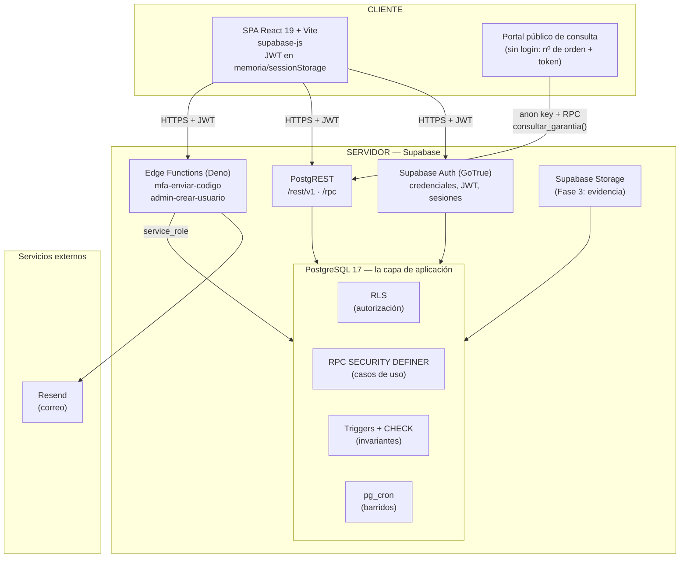
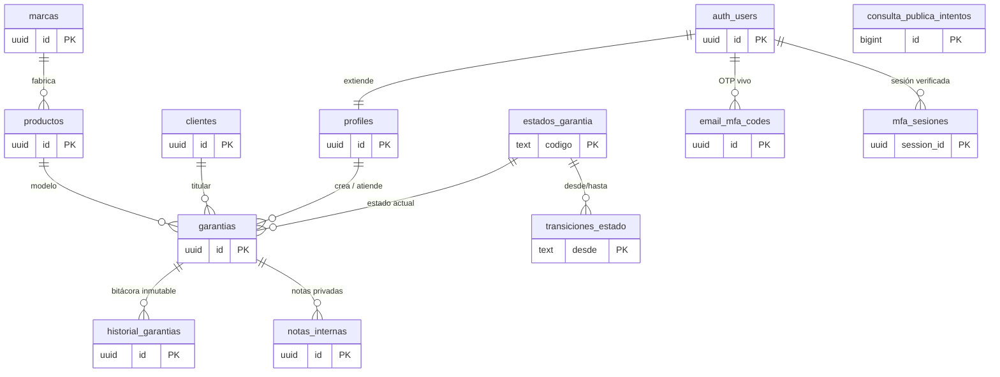
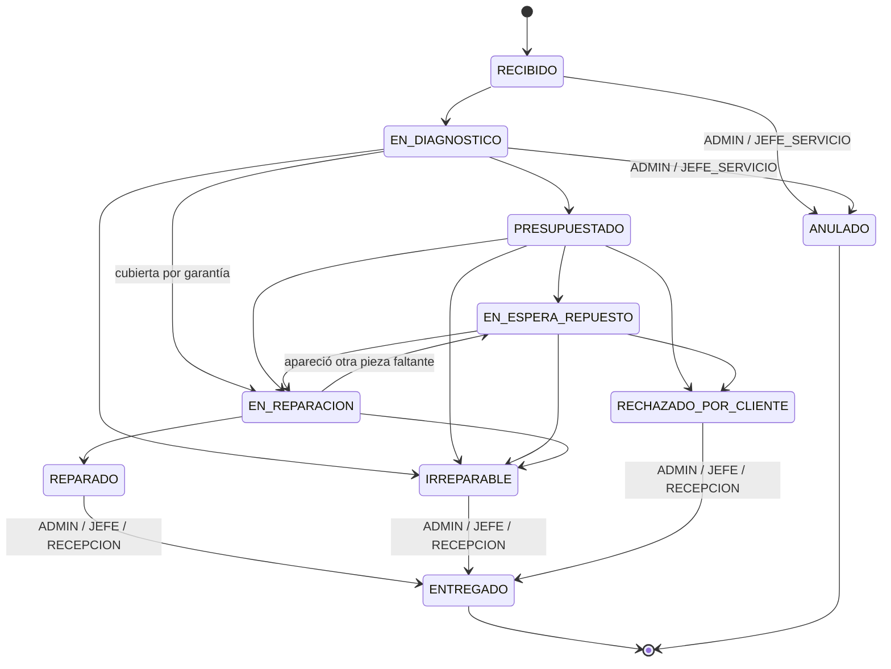
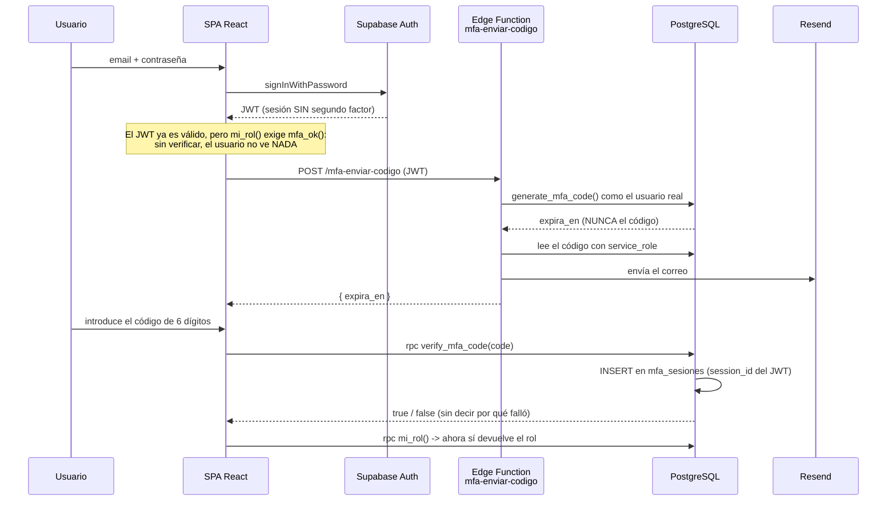
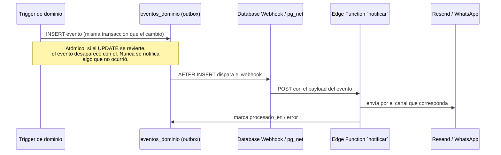
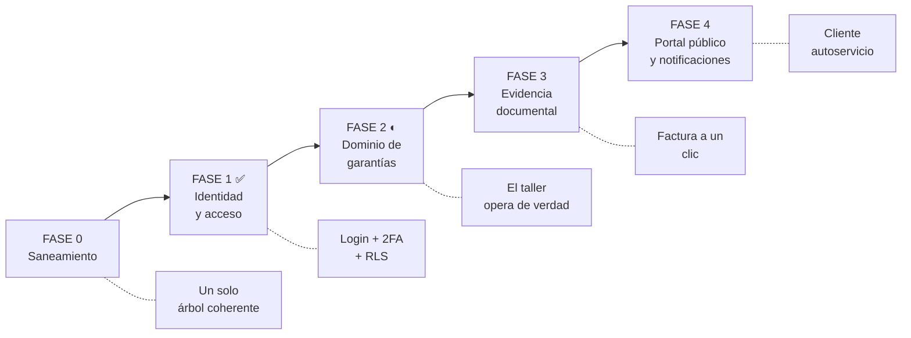
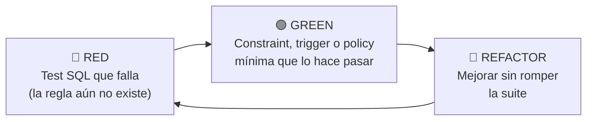

# Blueprint Maestro — Arquitectura Supabase

## Sistema de Registro, Gestión y Tracking de Garantías — "Prime Telecom"

> **Documento maestro vigente.** Reemplaza al *Blueprint de Arquitectura y Plan de Desarrollo por Fases* (backend Python + MySQL). Toda decisión de código posterior debe poder trazarse hasta este documento. El apéndice A mapea sección por sección qué reemplaza a qué, para que la decisión quede documentada y no borrada.

**Fecha:** 2026-09-07
**Rol asumido:** Arquitecto de Software Senior
**Restricciones tecnológicas vigentes:** Modelo Cliente-Servidor · **Supabase** (PostgreSQL 17 + PostgREST + Auth + Edge Functions + Storage) · SPA React 19 + Vite
**Metodología transversal:** Test-First sobre la base de datos (pgTAP) y sobre el cliente (Vitest)

---

## Tabla de contenido

1. [Principio rector: Postgres-first](#1-principio-rector-postgres-first)
2. [Topología Cliente-Servidor](#2-topología-cliente-servidor)
3. [Modelo de datos real (PostgreSQL)](#3-modelo-de-datos-real-postgresql)
4. [Identidad, autorización y segundo factor](#4-identidad-autorización-y-segundo-factor)
5. [Eventos y notificaciones (outbox)](#5-eventos-y-notificaciones-outbox)
6. [Roadmap re-fasado](#6-roadmap-re-fasado)
7. [Directiva de calidad y pruebas](#7-directiva-de-calidad-y-pruebas)
8. [Estrategia del cliente (Frontend)](#8-estrategia-del-cliente-frontend)
9. [Apéndice A — Trazabilidad con el Blueprint anterior](#apéndice-a--trazabilidad-con-el-blueprint-anterior)
10. [Apéndice B — Inventario de saneamiento (Fase 0)](#apéndice-b--inventario-de-saneamiento-fase-0)
11. [Apéndice C — Registro de decisiones (ADR)](#apéndice-c--registro-de-decisiones-adr)

---

## 1. Principio rector: Postgres-first

### 1.1 El cambio de eje

El Blueprint anterior organizaba el sistema como un **Monolito Modular en Python** bajo Clean Architecture: el dominio era código Python puro, y la base de datos era "un detalle" que se conectaba al final. Esa arquitectura fue construida parcialmente y **abandonada**: hoy no existe carpeta `backend/` en el repositorio.

La arquitectura vigente invierte la relación. **La base de datos es la capa de aplicación.** Las reglas de negocio, la autorización y los invariantes viven en PostgreSQL, y todo lo demás —el navegador, las Edge Functions— son clientes de esa base.

Esto no es una degradación de la Arquitectura Limpia; es la misma disciplina con otra frontera. La regla de dependencia se conserva: **nadie por encima de la base de datos puede violar una regla de negocio, porque la regla no está por encima**. Un `UPDATE` directo desde PostgREST, desde el SQL Editor o desde un script queda igual de sujeto a la máquina de estados que la propia interfaz. En la arquitectura anterior, saltarse la capa de aplicación significaba saltarse las reglas; aquí no hay forma de saltárselas.

### 1.2 La regla de frontera (innegociable)

Cada responsabilidad tiene un único lugar donde vive. Cuando surja la duda "¿dónde pongo esto?", esta tabla la resuelve:

| Responsabilidad | Dónde vive | Mecanismo | Ejemplo vigente en el código |
|---|---|---|---|
| **Autorización** (quién puede tocar qué fila) | PostgreSQL | RLS + funciones `SECURITY DEFINER` | `gar_update_tecnico`, `mi_rol()`, `es_admin()` |
| **Invariantes de datos** (qué estados son posibles) | PostgreSQL | `CHECK`, FK, `UNIQUE`, triggers | `ck_entregado_tiene_fecha`, `trg_validar_transicion` |
| **Casos de uso** (operaciones de negocio compuestas) | PostgreSQL | RPC `SECURITY DEFINER` | `crear_garantia()`, `consultar_garantia()`, `verify_mfa_code()` |
| **Efectos externos y privilegio elevado** | Edge Functions (Deno) | `service_role`, red saliente | `mfa-enviar-codigo` (Resend), `admin-crear-usuario` |
| **Presentación e interacción** | SPA React | Componentes + `supabase-js` | `features/auth`, `features/tablero` |

**Corolario operativo:** una regla de negocio nueva se implementa primero como constraint o trigger. Solo si es imposible expresarla en SQL pasa a una RPC. Solo si necesita salir a la red o usar `service_role` pasa a una Edge Function. **Nunca se implementa una regla de negocio en React**: el cliente valida para dar buena UX, no para proteger nada.

### 1.3 Por qué esta arquitectura es defendible académicamente

- **Una sola fuente de verdad.** No hay dos implementaciones de la misma regla (una en Python y otra en la BD) que puedan divergir.
- **Superficie de ataque mínima.** Sin servidor propio no hay servidor propio que endurecer, parchear ni desplegar. La autenticación la resuelve un proveedor especializado.
- **Verificabilidad.** Cada regla es un test SQL que se ejecuta contra la base real. La prueba no simula la producción: es la producción.
- **Trazabilidad de decisiones.** El apéndice C documenta cada decisión arquitectónica con su alternativa descartada y su motivo, que es exactamente lo que una defensa de tesis exige.

---

## 2. Topología Cliente-Servidor

### 2.1 Diagrama de despliegue



### 2.2 Contrato de comunicación

- **Transporte:** JSON sobre HTTPS. No hay API REST escrita a mano: **PostgREST genera los endpoints** a partir del esquema. Una tabla con RLS es un endpoint; una función es un `/rpc/<nombre>`.
- **Autenticación interna:** Supabase Auth emite un JWT firmado. `supabase-js` lo adjunta automáticamente en cada petición. PostgREST lo valida y expone `auth.uid()` y `auth.jwt()` dentro de cada sentencia SQL — que es lo que consumen las políticas RLS.
- **Autenticación pública (B2C):** el portal de consulta **no usa login ni magic link**. Usa la clave `anon` y llama a `consultar_garantia(numero_orden, token)`. El token es un secreto de 128 bits que se guarda **solo hasheado** (SHA-256) y se entrega en claro exactamente una vez, al crear la orden.
- **Versionado:** el versionado lo da la migración, no la ruta. Un cambio incompatible se introduce como función nueva (`consultar_garantia_v2`) manteniendo la anterior hasta que el cliente migre.
- **Documentación viva:** PostgREST publica OpenAPI derivado del esquema; los `COMMENT ON` de las migraciones son la documentación de cada objeto.

### 2.3 El rol de las Edge Functions

Las Edge Functions **no son la capa de aplicación**. Existen solo para dos cosas que Postgres no debe hacer:

1. **Salir a la red hacia un tercero.** `mfa-enviar-codigo` llama a Resend. La base de datos no hace peticiones HTTP salientes en el camino crítico de una transacción.
2. **Operar con `service_role`.** `admin-crear-usuario` crea cuentas en `auth.users`, algo que ningún JWT de usuario puede hacer.

Ambas validan el JWT del invocante (`verify_jwt` activo) y **derivan la identidad del token, nunca del cuerpo de la petición**. Una Edge Function que reciba un `user_id` como parámetro y confíe en él es una escalada de privilegios.

---

## 3. Modelo de datos real (PostgreSQL)

### 3.1 Diagrama entidad-relación



### 3.2 Las cuatro decisiones de modelado que definen el sistema

**a) `estado` es una tabla-catálogo, no un ENUM.** Un ENUM de PostgreSQL no permite borrar ni reordenar valores, y el catálogo de estados va a crecer. `estados_garantia` tiene 10 filas con `orden`, `es_final` y `activo`; añadir un estado es un `INSERT`, no una migración de tipo.

**b) La máquina de estados son datos, no código.** `transiciones_estado` almacena las 20 aristas válidas, cada una con `roles_permitidos` (un array de `app_role`, o `NULL` para "cualquiera con permiso de UPDATE"). El trigger `trg_validar_transicion` consulta esa tabla en cada `UPDATE`. Consecuencia: **la regla de negocio es consultable**. La interfaz puede preguntar "¿a qué estados puedo mover esta orden?" y recibir la respuesta de la misma fuente que la hace cumplir, sin duplicar la lógica en JavaScript.



**c) `estado` y `cobertura` son ejes independientes.** El Blueprint anterior los mezclaba: `warranties.status` valía `ACTIVE/EXPIRED/VOIDED` y `service_orders.status` era el flujo del taller, con `verdict` como tercer eje solapado. El modelo vigente separa:

- **`estado`** (10 valores, tabla): *dónde está el equipo* — el flujo operativo del taller.
- **`cobertura`** (ENUM de 4 valores): *quién paga* — `POR_DETERMINAR` → `EN_GARANTIA` | `FUERA_DE_GARANTIA` | `ANULADA_POR_USO`.

Son ortogonales: un equipo `EN_REPARACION` puede estar `EN_GARANTIA` o `FUERA_DE_GARANTIA`, y eso cambia quién paga, no dónde está. Confundirlos era la raíz del `verdict` del documento anterior.

**d) La unidad de negocio es la orden, no la unidad física.** El Blueprint anterior hacía girar todo alrededor de `hardware_units.serial_number` con `UNIQUE`. La realidad del taller es que llegan equipos sin serial legible, con serial repetido de fábrica, o el mismo equipo vuelve tres veces. Por eso `garantias.numero_serie` es **nullable y no único**, y la identidad la da `numero_orden` (`ORD-2026-000001`, secuencial, dictable por teléfono). La trazabilidad por serial se obtiene consultando, no imponiendo unicidad sobre un dato que el negocio no controla.

### 3.3 Invariantes que la base hace cumplir

| Constraint | Qué impide |
|---|---|
| `ck_entregado_tiene_fecha` | Que una orden esté `ENTREGADO` sin `fecha_entrega`, o que la tenga sin estarlo |
| `ck_entrega_posterior_al_ingreso` | Entregar antes de recibir |
| `ck_anulacion_cobertura_justificada` | Anular la cobertura sin escribir el motivo |
| `ck_costo_solo_si_no_cubierta` | Cobrarle a un cliente cuyo equipo está `EN_GARANTIA` |
| `trg_validar_transicion` | Cualquier salto ilegal de la máquina de estados, incluido por rol |
| `trg_historial_inmutable` | Editar o borrar una línea de la bitácora |
| `uq_marcas_nombre` sobre `lower(btrim(nombre))` | Que "Samsung", "samsung " y "SAMSUNG" sean tres marcas |
| Sin policy de `INSERT` en `garantias` | Crear una orden por fuera de `crear_garantia()`, que es el único sitio donde el token existe |
| `garantias` sin `DELETE` | Borrar historia. Una orden errónea pasa a `ANULADO` |

### 3.4 Separación de la información sensible

`notas_internas` es una tabla aparte, no una columna de `garantias`, **a propósito**: ninguna ruta que lea `garantias` —incluido un `SELECT *` mal filtrado o la RPC pública— puede filtrarla por accidente. El mismo razonamiento aplica a `email_mfa_codes`, que no tiene ni un `GRANT` para `anon` ni `authenticated`, RLS activa y **cero políticas**: es invisible salvo para `service_role` y para las funciones `SECURITY DEFINER` de su propia migración.

### 3.5 Evidencia documental (Fase 3, pendiente)

Sustituye a `attachments` + volumen local/S3 del documento anterior:

- **Binarios en Supabase Storage**, bucket privado `evidencia`, con políticas de acceso por rol.
- **Tabla `adjuntos`** con los metadatos y la clave del objeto — nunca el binario.
- **Descarga mediante URL firmada de vida corta**, emitida solo tras comprobar RLS. Se conserva íntegra la regla del documento anterior: ningún documento es accesible por adivinar la ruta.
- **Sin OCR**, igual que antes: el valor es la centralización de la evidencia, no interpretarla.

---

## 4. Identidad, autorización y segundo factor

### 4.1 Los cuatro roles

`app_role` es un ENUM con cuatro valores, **distintos de los del Blueprint anterior** porque describen el taller real y no un comercio genérico:

| Rol | Qué puede hacer |
|---|---|
| `ADMIN` | Gestiona usuarios y catálogos; ve todo |
| `JEFE_SERVICIO` | Asigna técnicos, anula órdenes, ve todo |
| `TECNICO` | Solo trabaja las órdenes asignadas a él |
| `RECEPCION` | Crea órdenes y atiende al cliente; no diagnostica |

**Correspondencia con los roles del documento anterior:** `ADMIN`→`ADMIN`, `SUPERVISOR`→`JEFE_SERVICIO`, `TECNICO`→`TECNICO`, `VENDEDOR`→`RECEPCION`. El cambio de nombre es deliberado: en este negocio no se vende, se recibe.

### 4.2 Las tres barreras contra la escalada de privilegios

El esquema resuelve tres ataques concretos, y cada mecanismo existe por uno de ellos:

1. **Alta de usuario.** `handle_new_user()` fija el rol como **constante** (`TECNICO`). La versión ingenua leía `raw_user_meta_data->>'role'`, que lo controla el cliente en el `signUp`: cualquiera que se registrara con `{"role":"ADMIN"}` era administrador.
2. **Edición del propio perfil.** La RLS deja al usuario editar *su* fila para cambiarse el nombre. `proteger_columnas_de_profile` decide **qué columnas**: bloquea el cambio de `role` y del correo espejo, e impide que el último ADMIN se auto-degrade dejando el sistema sin administrador. *La RLS decide qué fila; el trigger decide qué columna. Hacen falta los dos.*
3. **`search_path` en `SECURITY DEFINER`.** Toda función con privilegio elevado fija `SET search_path = public, pg_temp`. Sin eso, quien pueda crear objetos en algún esquema del path antepone su propia `digest()` y ejecuta código como el dueño de la función.

### 4.3 Por qué `mi_rol()` es `SECURITY DEFINER`

Toda política que diga "si soy ADMIN" necesita leer `profiles`. Si esa lectura la hace el usuario invocante, la RLS de `profiles` se evalúa otra vez, y esa evaluación vuelve a leer `profiles`: PostgreSQL aborta con `42P17 infinite recursion detected in policy`. La función `SECURITY DEFINER` se ejecuta como su dueño, que no está sujeto a RLS. **Consecuencia arquitectónica permanente: este esquema nunca usa `FORCE ROW LEVEL SECURITY` sobre `profiles`**, porque rompería estas funciones.

Se marcan `STABLE` para que el planificador las evalúe una vez por sentencia y no una vez por fila.

### 4.4 Segundo factor: OTP por correo (directiva vigente)

**Directiva innegociable del proyecto: la fuente de verdad del 2FA es el OTP por correo.** El TOTP de Supabase Auth queda descartado, y toda referencia a él se elimina de la documentación y la configuración (ver Fase 0 y ADR-004).



**Las cuatro propiedades que hacen real este segundo factor:**

1. **La verificación se ancla a la sesión, no al usuario.** `mfa_sesiones` tiene como PK el `session_id` del JWT. Un token robado antes de verificar no sirve: le falta su fila. Verificar en el móvil no valida la sesión del portátil. Cerrar sesión y volver a entrar exige código nuevo.
2. **El cierre lo hace Postgres, no React.** `mi_rol()` exige `mfa_ok()`. Si alguien salta la pantalla del código con las herramientas del navegador, PostgREST le devuelve lo mismo que a un desconocido. Una pantalla de OTP que solo controla el enrutado de React es decorativa.
3. **El código nunca viaja al navegador.** `generate_mfa_code()` devuelve la caducidad; el código solo lo lee la Edge Function con `service_role` para enviarlo por correo. Cero `console.log` del código.
4. **El código se guarda en claro, a propósito.** Hashear un OTP de 6 dígitos es teatro: hay 10⁶ preimágenes. Lo que protege la tabla es que nadie puede leerla (sin GRANT, RLS activa, cero políticas) y que vive 5 minutos. La defensa real contra fuerza bruta es el contador `intentos` (a los 5, el código se quema) y la ventana anti-mailbomb.

**Caducidad:** `mfa_ok()` comprueba las 12 horas **en la propia función**, no solo en el barrido de `pg_cron`. Si el cron se detiene, el permiso caduca igual. `mfa_limpiar()` es una función y no SQL suelto dentro de `cron.schedule` para poder probarla sin `pg_cron` instalado.

---

## 5. Eventos y notificaciones (outbox)

### 5.1 El problema se conserva; la solución cambia de sustrato

El antipatrón que el Blueprint anterior identificaba sigue siendo un antipatrón: que la regla de negocio llame directamente al proveedor de correo. Cambiar de proveedor obligaría a tocar el corazón del taller.

Lo que cambia es la implementación. **No hay bus en memoria** —no hay proceso donde vivir— y tampoco hace falta: PostgreSQL ya tiene transacciones, y una tabla es un bus durable.

### 5.2 Patrón outbox transaccional



**Por qué outbox y no una llamada HTTP desde el trigger:** un `pg_net` dentro del camino crítico ata el tiempo de respuesta del taller a la latencia de un tercero, y un fallo de red revierte una transacción de negocio válida. Con outbox, anular una cobertura es instantáneo para el técnico y la notificación viaja después, con reintentos y sin perderse.

**Ventaja sobre el bus en memoria del documento anterior:** el bus in-memory perdía los eventos al reiniciar el proceso. La tabla sobrevive al reinicio, es auditable (`SELECT * FROM eventos_dominio WHERE procesado_en IS NULL`) y da reintentos gratis.

### 5.3 Catálogo de eventos de dominio

| Evento | Emitido por | Disparador | Reacción |
|---|---|---|---|
| `OrdenCreada` | `crear_garantia()` | Alta de orden | Comprobante con nº de orden + token de consulta |
| `EstadoCambiado` | `trg_historial_garantia` | Toda transición válida | Aviso de avance al cliente |
| `CoberturaDeterminada` | Trigger de cobertura | `POR_DETERMINAR` → cualquier otro | Informar si cubre o no, y el costo si aplica |
| `CoberturaAnulada` | Trigger de cobertura | `cobertura = ANULADA_POR_USO` | Notificar la anulación **con el motivo** |
| `EquipoListo` | `trg_historial_garantia` | Estado → `REPARADO` / `IRREPARABLE` | Avisar que puede retirarlo |
| `GarantiaPorVencer` | `pg_cron` diario | `garantia_vence_el` en N días | Recordatorio proactivo |

Los tres primeros ya tienen su trigger escrito; lo único que falta es el `INSERT` en el outbox.

### 5.4 Contrato de canal

La Edge Function `notificar` es el único adaptador. Un canal nuevo (WhatsApp) es una rama más en un `switch` sobre `evento.canal`, o una función hermana. **El SQL de dominio nunca sabe qué canal existe**: escribe un evento y termina. Es el mismo desacoplamiento de puertos y adaptadores del documento anterior, con el puerto expresado como forma del payload en vez de como interfaz de Python.

---

## 6. Roadmap re-fasado

El roadmap anterior (Fases 1–4 sobre Python/MySQL) queda sustituido. Las fases se re-numeran contra lo que **existe de verdad hoy en el repositorio**, no contra lo planeado.



### Fase 0 — Saneamiento ✅ **completada (2026-09-08)**

**Objetivo:** que exista un solo árbol coherente. Hoy el repositorio contiene dos migraciones con el **mismo timestamp** (`20260906000001`), un fichero de referencia que nunca se aplica pero contiene correcciones que la migración activa no tiene, y ~3.500 líneas de documentación que describen un backend que no existe.

| Tarea | Detalle |
|---|---|
| Resolver la colisión de timestamps | `esquema_inicial.sql` y `auth_base.sql` comparten `20260906000001`. `garantias.sql` declara depender solo de `auth_base`. Se elimina el huérfano |
| Rescatar las correcciones del fichero `_referencia_` | Contiene fixes (email nullable, índice parcial, RLS de `profiles`) que deben vivir en una migración con timestamp propio, no en un fichero inerte |
| Eliminar la documentación fantasma | `AUTH_BLUEPRINT.md`, la auditoría Fase 11, el design duplicado en la raíz y `Claude outputs/` describen el backend Flask/MySQL abandonado |
| **Eliminar todo rastro de TOTP** | Nota de post-instalación de `garantias.sql`, bloque `[auth.mfa.totp]` de `config.toml` y menciones en documentación. **El 2FA del proyecto es el OTP por correo** (ADR-004) |
| Revertir la regresión de contraseña | `MIN_PASSWORD` está en 5 en `Login.jsx`; la auditoría del propio proyecto (CSO-07) exige 12 |
| Podar dependencias sin uso | `tailwindcss` + `@tailwindcss/vite` (instalado, cero clases usadas) y `@fontsource/ibm-plex-sans` (sin importar) |

**Criterio de aceptación:** `supabase db reset` corre limpio desde cero sobre una base vacía; no queda ningún documento vigente que mencione Python, MySQL, Flask ni TOTP.

**Resultado.** Cumplido. Cinco migraciones sin colisión de timestamps, aplicadas en orden desde una base vacía, con 110 pruebas verdes. Dos matices sobre lo planificado:

- **No había nada que rescatar del fichero `_referencia_`.** Contiene exactamente los mismos 86 objetos que `auth_base` + `garantias`, y las cinco correcciones que el audit le atribuía ya estaban vivas en `auth_base`. El hallazgo era cierto frente a `esquema_inicial`, no frente a la migración vigente.
- **CSO-07 no se arregla solo en `Login.jsx`.** Subir el mínimo únicamente en el formulario de login habría dejado sin poder enviarlo a cualquiera con una contraseña de 6 a 11 caracteres. El mínimo se sube a 12 en los dos sitios: el formulario y `minimum_password_length` de `config.toml`. Los hallazgos de seguridad que sobreviven a Supabase quedan en `docs/deuda-seguridad.md`.

### Fase 1 — Identidad y acceso ✅ **completada**

Auth de Supabase, `profiles` con rol, RLS anti-recursión, triggers anti-autoescalada, 2FA por OTP de correo anclado a sesión, Edge Function de alta de usuarios. Cubierta por `98_pruebas_auth_base.sql`, `96_pruebas_mfa.sql`, `97_pruebas_rechazos.sql` y `99_pruebas_seguridad.sql`.

**Deuda declarada:** el flujo de login necesita las pruebas que el commit `b81e632` dejó pendientes.

### Fase 2 — Dominio de garantías ◐ **esquema listo, interfaz pendiente**

El SQL está: catálogos, máquina de estados, cobertura calculada por trigger, historial inmutable, RLS por rol, `crear_garantia()`. **Lo que falta es que la aplicación lo use**: el Tablero todavía renderiza `datosDemo.js`.

| Se construye | Detalle |
|---|---|
| Conectar el Tablero a datos reales | Sustituir `datosDemo.js` por consultas a `garantias` bajo RLS |
| Leer los catálogos de la base | `dominio.js` deja de ser el catálogo y pasa a leer `estados_garantia`; solo sobrevive el mapa de clases CSS, porque el color no está en la base ni debe estarlo |
| Pantalla de alta de orden | Formulario contra `crear_garantia()`, con la entrega **única** del token de consulta al imprimir el comprobante |
| Transición de estado en la UI | Los destinos posibles se consultan a `transiciones_estado`, no se codifican en React |
| Vistas por rol | `TECNICO` ve lo asignado; `RECEPCION` da de alta y entrega; `JEFE_SERVICIO` asigna y anula |

**Criterio de aceptación:** una orden completa recorre `RECIBIDO → ENTREGADO` desde la interfaz, con cada transición registrada en `historial_garantias` y rechazada cuando el rol no corresponde.

### Fase 3 — Evidencia documental

Supabase Storage (bucket privado) + tabla `adjuntos` + URL firmadas de vida corta. Sustituye al `attachments` sobre volumen local/S3 del documento anterior (§3.5).

**Criterio de aceptación:** desde la ficha de una orden se descarga la factura escaneada con un clic; una petición sin JWT válido no obtiene el archivo aunque conozca la ruta.

### Fase 4 — Portal público y notificaciones

La RPC pública **ya existe y es más robusta que lo especificado**: `consultar_garantia()` con token de 128 bits, anti-enumeración y freno de fuerza bruta por IP. Falta la pantalla y el motor de avisos.

| Se construye | Detalle |
|---|---|
| Pantalla de consulta pública | Formulario `nº de orden + token` contra la RPC; sin login, sin datos internos |
| Tabla `eventos_dominio` (outbox) | `INSERT` desde los triggers que ya escriben el historial |
| Edge Function `notificar` | Consume el outbox vía webhook y despacha por Resend |
| Barrido `pg_cron` | `GarantiaPorVencer` + purga de `consulta_publica_intentos` (crece sin techo) |

**Criterio de aceptación:** un token válido muestra solo su orden; uno alterado devuelve exactamente lo mismo que uno inexistente (cero filas); tras 10 fallos desde una IP, la consulta se frena 15 minutos.

### 6.1 Resumen

| Fase | Estado | Entrega tangible | Depende de |
|---|---|---|---|
| **0. Saneamiento** | Pendiente | Un árbol coherente, `db reset` limpio | — |
| **1. Identidad** | ✅ Completada | Login + 2FA por correo + RLS | Fase 0 |
| **2. Dominio** | ◐ SQL listo, UI pendiente | El taller opera sin planilla física | Fase 1 |
| **3. Evidencia** | Pendiente | Factura y orden a un clic | Fase 2 |
| **4. Portal + avisos** | Pendiente | Cliente autoservicio y alertas | Fases 2–3 |

---

## 7. Directiva de calidad y pruebas

### 7.1 El ciclo sobrevive; cambia el sujeto

El Blueprint anterior probaba **el dominio Python en memoria, sin base de datos**. Aquí el dominio *es* la base de datos, así que probarlo "sin base de datos" no significaría nada: probaría un modelo del sistema, no el sistema.

La disciplina Red → Green → Refactor se conserva íntegra, ejecutada con **pgTAP contra una instancia local de Supabase**, que es idéntica a la de producción. La suite vive en `supabase/tests/` y ya tiene 784 líneas.



### 7.2 Qué se prueba, y dónde

| Capa | Herramienta | Qué verifica |
|---|---|---|
| Invariantes y máquina de estados | pgTAP | Toda transición válida pasa; toda inválida se rechaza, incluida por rol |
| Autorización | pgTAP con JWT simulado | Un `TECNICO` no actualiza una orden ajena; `anon` no lee ninguna tabla |
| Segundo factor | pgTAP | El código se quema a los 5 intentos; `mfa_ok()` es falso a las 12 h; el código nunca sale en un `RETURNS` |
| Superficie pública | pgTAP | `consultar_garantia()` devuelve idéntico ante token malo y orden inexistente |
| Interfaz | Vitest + Testing Library | Estados de carga, error y vacío; que el token de consulta se muestre una sola vez |

### 7.3 La regla de oro, reescrita

> **La interfaz y las Edge Functions son detalles de entrega.** El comportamiento del negocio se define, se prueba y se refactoriza **en la base de datos**. Un test de dominio que necesite abrir el navegador rompió la frontera y debe corregirse. Y a la inversa: una regla que solo la interfaz hace cumplir **no es una regla**, es una sugerencia.

### 7.4 Prueba de humo obligatoria antes de cada despliegue

Con la clave `anon`, estas tres deben fallar:

```sql
select * from garantias;                            -- 0 filas / permiso denegado
select * from profiles;                             -- 0 filas / permiso denegado
select consultar_garantia('ORD-2026-000001','xx');  -- 0 filas
```

Y con un JWT de `TECNICO` sin segundo factor superado, `select mi_rol()` no debe devolver rol alguno.

---

## 8. Estrategia del cliente (Frontend)

### 8.1 Stack vigente

React 19 + Vite + `supabase-js` + React Router, en JavaScript (no TypeScript). Organización **feature-based**, espejo de los dominios: `features/auth`, `features/tablero`, `features/paneles`, con `lib/supabaseClient.js` como única instancia del cliente.

**Diferencia con el documento anterior:** ya no hay instancia de `axios` con interceptores ni gestión manual del JWT. `supabase-js` adjunta el token, lo refresca y expone `onAuthStateChange`. El equivalente del "interceptor de respuesta" es la política RLS: **un `403` ya no ocurre — lo que ocurre es que la consulta devuelve cero filas**, y la interfaz debe tratar "vacío" como un estado de primera clase, no como un error.

### 8.2 Las tres reglas del cliente

1. **El cliente nunca decide un permiso.** Ocultar un botón es cortesía visual; quien impide la acción es la RLS. Toda pantalla debe seguir siendo correcta si el usuario la fuerza a mano.
2. **El vocabulario es el de la base.** Los códigos de estado y cobertura que usa la interfaz son literalmente los de `estados_garantia` y `cobertura_garantia`. Nunca se inventan etiquetas propias: cada traducción es un sitio donde se pierde un estado en silencio. Lo único que la interfaz sí posee es el **color** — el color no está en la base ni debe estarlo.
3. **La sesión incluye el segundo factor.** `autenticado` significa *JWT válido **y** `mfa_ok()`*. Un usuario con JWT pero sin verificar no está autenticado a efectos de enrutado, exactamente como no lo está a efectos de PostgREST.

### 8.3 Persistencia de la sesión

El checkbox "recordarme" elige entre `localStorage` (persistente) y `sessionStorage` (muere con la pestaña). **No significa saltarse el 2FA**: la política es segundo factor en cada sesión nueva, y `mfa_sesiones` lo hace cumplir por `session_id`.

---

## Apéndice A — Trazabilidad con el Blueprint anterior

Ninguna sección del documento anterior se borra sin sustituto. Esta tabla es el mapa de la migración arquitectónica.

| Blueprint anterior (Python + MySQL) | Documento vigente | Qué lo reemplaza y por qué |
|---|---|---|
| §1.1 Monolito Modular + Clean Architecture | §1.1–1.2 | **Postgres-first.** El backend Python nunca llegó al repositorio; la regla de negocio se movió a la BD, donde nadie puede saltársela |
| §1.2 Topología con API REST propia | §2.1–2.2 | **PostgREST** genera los endpoints desde el esquema. No se escribe API a mano |
| §1.4 Capas Dominio/Aplicación/Infraestructura/Presentación | §1.2 Regla de frontera | Las cuatro capas se colapsan en cinco responsabilidades con un lugar único cada una |
| §1.5 Cuatro dominios (Identity/Sales&Warranty/Workshop/Notifications) | §3, §4, §5 | `Identity`→Auth+`profiles`+RLS; `Sales&Warranty`+`Workshop`→ un solo dominio de **orden de servicio con cobertura**; `Notifications`→ outbox |
| §2.3 DDL MySQL/InnoDB | §3.2–3.3 | Esquema PostgreSQL real. Los ENUM de estado pasan a tabla-catálogo; el serial deja de ser la identidad |
| §2.4 `warranties.status` + `service_orders.status` + `verdict` | §3.2(c) | Se separan en **dos ejes ortogonales**: `estado` (dónde está) y `cobertura` (quién paga) |
| §2.5 `attachments` sobre volumen local / S3 | §3.5 (Fase 3) | **Supabase Storage** + tabla `adjuntos` + URL firmadas |
| §3.2 Event Bus in-memory publish/subscribe | §5.2 | **Outbox transaccional + Database Webhook.** Durable, auditable, con reintentos |
| §3.4 Puerto `NotificationChannel` + adaptadores Python | §5.4 | Edge Function `notificar` como único adaptador; el puerto es la forma del payload |
| §4 Fases 1–4 (dominio → taller → web+MySQL → B2C) | §6 | Re-fasado contra lo que existe. La Fase 4 anterior (portal B2C) **ya está implementada en SQL** |
| §5 TDD en memoria sin base de datos | §7.1–7.3 | **pgTAP contra Supabase local.** El ciclo se conserva; el sujeto es la BD |
| §5.3 "La base de datos es un detalle" | §7.3 | Se invierte: la base de datos es el dominio; la interfaz es el detalle |
| §6.1 React + Vite + TypeScript | §8.1 | React 19 + Vite en JavaScript. TypeScript queda como mejora opcional |
| §6.3 Interceptores axios + manejo de 401/403 | §8.1 | `supabase-js` gestiona el token. Un `403` se convierte en **cero filas**: "vacío" es un estado de primera clase |
| §7 Plan de arranque Día 1 (venv, pytest, primer RED) | §6 Fase 0 | El arranque ya ocurrió. Su equivalente hoy es el saneamiento |
| Roles `ADMIN/VENDEDOR/TECNICO/SUPERVISOR` | §4.1 | `ADMIN/RECEPCION/TECNICO/JEFE_SERVICIO`. En este negocio no se vende, se recibe |
| Magic Link con JWT de alcance limitado (§4 Fase 4) | §2.2, §6 Fase 4 | **Nº de orden + token de 128 bits hasheado.** Sin JWT que caduque ni firme que rotar; el token se puede imprimir en el comprobante |
| Worker asíncrono (APScheduler / Celery beat) | §4.4, §6 Fase 4 | **`pg_cron`** dentro de Postgres. Un proceso menos que desplegar y vigilar |
| Alembic | §6 Fase 0 | Migraciones SQL versionadas por timestamp, aplicadas con el CLI de Supabase |
| SQLAlchemy / repositorios ORM | §2.2 | PostgREST. El "repositorio" es la tabla con su RLS |
| JWT propio + `password_hash` en `users` | §4 | Supabase Auth (GoTrue). `profiles` extiende `auth.users`, nunca la duplica |
| 2FA por correo sobre Flask (`AUTH_BLUEPRINT.md`) | §4.4 | Mismo concepto, implementado en PL/pgSQL + Edge Function. **Se conserva como directiva del proyecto** |

---

## Apéndice B — Inventario de saneamiento (Fase 0)

Hallazgos de la auditoría de sobre-ingeniería, ordenados por tamaño del corte. **Nada de esto se ejecuta hasta aprobar este documento.**

| # | Acción | Objeto | Motivo |
|---|---|---|---|
| 1 | Eliminar | `supabase/migrations/20260906000001_esquema_inicial.sql` (1.120 líneas) | Mismo timestamp que `auth_base.sql`; si ambos corren, `CREATE TYPE app_role` colisiona. `garantias.sql` declara depender solo de `auth_base` |
| 2 | Rescatar y eliminar | `_referencia_20260906000001_esquema_inicial.sql` (1.168 líneas) | Nunca se aplica (el prefijo lo excluye), pero contiene fixes que la migración activa no tiene. Los fixes van a una migración nueva; el fichero se va |
| 3 | Eliminar | `AUTH_BLUEPRINT.md` (738 líneas) | Documenta Flask + MySQL + SQLAlchemy + Argon2. Arquitectura abandonada. Su contenido vigente (el diseño del 2FA) queda absorbido en §4.4 |
| 4 | Eliminar | `2026-09-05-auth-fase-1a-design.md` (raíz) | Duplicado byte a byte de `docs/specs/` — y ambos describen el backend fantasma |
| 5 | Eliminar | `docs/2026-09-06-auditoria-fase-11.md` | Audita `backend/` con 223 tests de pytest, que no existe. **Antes de borrar: extraer CSO-07 y CSO-10**, que siguen siendo válidos |
| 6 | Eliminar | `Claude outputs/` (~288 KB) | Backend Flask completo, zips de pasos de Alembic, `create_superuser.py`. Basura de sesiones previas |
| 7 | **Eliminar (directiva)** | Toda referencia a **TOTP** | Nota 3 de post-instalación de `garantias.sql`, bloque `[auth.mfa.totp]` de `config.toml`, menciones en documentación. **El 2FA del proyecto es el OTP por correo** |
| 8 | Corregir | `MIN_PASSWORD` en `Login.jsx` | Está en **5**; CSO-07 del propio proyecto exige **12**. Es una regresión de seguridad |
| 9 | Podar | `tailwindcss`, `@tailwindcss/vite` | Instalado e importado en `index.css`, con cero clases utilitarias en todo el código. El estilo es CSS a mano |
| 10 | Podar | `@fontsource/ibm-plex-sans` | Sin ninguna importación en el código |
| 11 | Simplificar | `scripts/setup-supabase-mfa.sh` | 183 de sus 321 líneas son un framework de wizard para un script de un solo uso |

**Neto estimado:** −3.550 líneas, −3 dependencias.

**Fuera de alcance de la Fase 0** (se registran como deuda, no se tocan ahora): la tabla `mfa_sesiones` solapa parcialmente con `auth.sessions`; `profiles.is_active` solapa con el baneo nativo de Supabase Auth; `crearAlmacenamiento()` en `supabaseClient.js` son ~25 líneas para un `if`. Los tres funcionan y están probados; tocarlos ahora es riesgo sin beneficio.

---

## Apéndice C — Registro de decisiones (ADR)

### ADR-001 · La lógica de negocio vive en PostgreSQL

**Contexto.** El backend Python del blueprint original se construyó a medias y se abandonó. Había que decidir dónde reconstruir el dominio.
**Decisión.** Postgres-first: RLS para autorización, constraints y triggers para invariantes, RPC `SECURITY DEFINER` para casos de uso.
**Alternativa descartada.** Reconstruir la Clean Architecture en Edge Functions de Deno, conservando el dominio testeable en memoria.
**Motivo.** Con la lógica en la BD, no existe camino que la evite: PostgREST, el SQL Editor y un script cualquiera quedan igual de sujetos a las reglas. Con la lógica en Edge Functions, cada nuevo cliente es una oportunidad de saltárselas.
**Consecuencia aceptada.** Las pruebas necesitan una base de datos; no hay tests de dominio "en memoria". Se asume: pgTAP contra Supabase local prueba el sistema real, no un modelo de él.

### ADR-002 · La máquina de estados es una tabla, no código

**Decisión.** `transiciones_estado(desde, hasta, roles_permitidos)` como datos; un trigger la hace cumplir.
**Alternativa descartada.** Un `CASE` en PL/pgSQL, o un ENUM con la lógica en la aplicación.
**Motivo.** La regla se vuelve consultable: la interfaz pregunta qué transiciones existen en vez de reimplementarlas. Añadir un estado es un `INSERT`, no una migración de tipo ni un despliegue.

### ADR-003 · El portal público usa token secreto, no magic link con JWT

**Decisión.** `numero_orden` + token de 128 bits, guardado solo como SHA-256, entregado en claro una única vez al crear la orden.
**Alternativa descartada.** El magic link con JWT de alcance limitado del blueprint original.
**Motivo.** El token se imprime en el comprobante de papel que el cliente ya se lleva. No caduca en un plazo que obligue a reemitirlo, no depende de que el correo llegue, y no arrastra la rotación de firma de un JWT. Se descartó además la consulta por cédula: una cédula no es un secreto, es corta, enumerable y pública.
**Consecuencia aceptada.** Quien pierde el comprobante pierde el acceso público; recuperarlo exige pasar por el taller, que es la política de negocio deseada.

### ADR-004 · El segundo factor es OTP por correo — el TOTP queda descartado

**Contexto.** La nota de post-instalación de `20260906000002_garantias.sql` proponía el TOTP nativo de Supabase; al día siguiente, `20260907000003_mfa_email.sql` implementó el OTP por correo y redefinió `mi_rol()` para exigir `mfa_ok()`. Dos documentos vigentes se contradecían.
**Decisión.** **Directiva del proyecto: la fuente de verdad del 2FA es el OTP por correo**, con `email_mfa_codes`, `mfa_sesiones` y la Edge Function de Resend. Todo rastro de TOTP se elimina del código, la configuración y la documentación (Fase 0, ítem 7).
**Alternativa descartada.** `supabase.auth.mfa.*` nativo, que ahorraría dos tablas, tres funciones, un job de `pg_cron` y una Edge Function.
**Motivo.** El TOTP exige que cada usuario del taller instale y mantenga una aplicación autenticadora, y que la organización gestione la pérdida del dispositivo. El correo corporativo ya existe, ya está gestionado, y el flujo de código de 6 dígitos no requiere formación. La implementación propia está además probada (`96_pruebas_mfa.sql`) y ancla la verificación al `session_id`, propiedad que el TOTP nativo no da por sí solo.
**Riesgo aceptado y documentado.** El buzón corporativo es el punto único de fallo del sistema de identidad: quien lo controla obtiene el segundo factor y el restablecimiento de contraseña. La mitigación es la seguridad del buzón, tratada como **precondición del sistema**. Cuando exista un canal de WhatsApp, ese segundo canal cierra el hueco.

### ADR-005 · Las notificaciones salen por outbox, no desde el trigger

**Decisión.** Los triggers de dominio insertan en `eventos_dominio`; un webhook despacha a la Edge Function `notificar`.
**Alternativa descartada.** `pg_net` llamando al proveedor desde el propio trigger.
**Motivo.** Una llamada HTTP dentro de la transacción ata el tiempo de respuesta del taller a un tercero, y un fallo de red revertiría un cambio de negocio válido. El outbox es atómico con el cambio: nunca se notifica algo que no ocurrió, y nunca se pierde algo que sí.

### ADR-006 · La identidad de la orden es `numero_orden`, no el número de serie

**Decisión.** `numero_serie` es nullable y no único; `numero_orden` (`ORD-2026-000001`) es la identidad de cara al cliente y al taller.
**Alternativa descartada.** `UNIQUE` sobre el serial, como en el blueprint original.
**Motivo.** Llegan equipos sin serial legible, con serial repetido de fábrica, y el mismo equipo vuelve varias veces. Imponer unicidad sobre un dato que el negocio no controla bloquea altas legítimas en el mostrador. Además, nadie dicta un UUID por teléfono sin equivocarse.

---

### ADR-011 · El token de consulta se regenera, no se recupera

**Contexto.** `crear_orden()` entrega el token en claro una sola vez. Si el comprobante se pierde, el cliente queda sin acceso al portal público de su orden y nadie puede devolvérselo: en la tabla solo está el SHA-256.
**Decisión.** `regenerar_token_orden(orden_id)` emite un token nuevo e **invalida el anterior**, con los mismos roles que `crear_orden()` y dejando nota en `notas_internas`.
**Alternativa descartada.** Guardar el token cifrado en vez de hasheado, para poder mostrarlo de nuevo.
**Motivo.** Cifrar exige una clave que vive en el mismo sistema que el dato: un volcado de la base con acceso a esa clave devuelve todos los tokens en claro, que es justo lo que el hash evita. Regenerar conserva la propiedad de que la base **no sabe** ningún token.
**Por qué deja rastro.** Una válvula de escape sin auditoría es una puerta trasera: permitiría a cualquiera con rol de mostrador emitirse acceso a la orden de un cliente sin constancia. La nota va en la misma transacción que el `UPDATE`, así que no hay forma de rotar el token en silencio. Se usa `notas_internas` —ya append-only, con autor y fecha— en vez de crear una tabla de auditoría nueva; `historial_garantias` no sirve porque su `CHECK` exige un cambio de estado, y esto no lo es.
**Consecuencia aceptada, y hay que decírsela al cliente.** El papel que tenga en la mano deja de servir en el momento en que se pulsa. No es reversible.
**Ensanchamiento deliberado de la RLS.** La función es `SECURITY DEFINER` y se salta `gar_update_recepcion`, que solo deja a RECEPCION tocar órdenes ya terminadas. Un cliente que perdió su comprobante aparece por el mostrador en cualquier punto del ciclo, no solo cuando el equipo está listo.

---

**Fin del documento.** Toda modificación de arquitectura posterior se incorpora como un ADR nuevo en el apéndice C, no reescribiendo el cuerpo en silencio.
